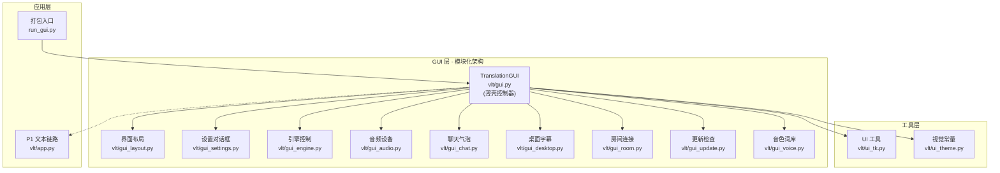
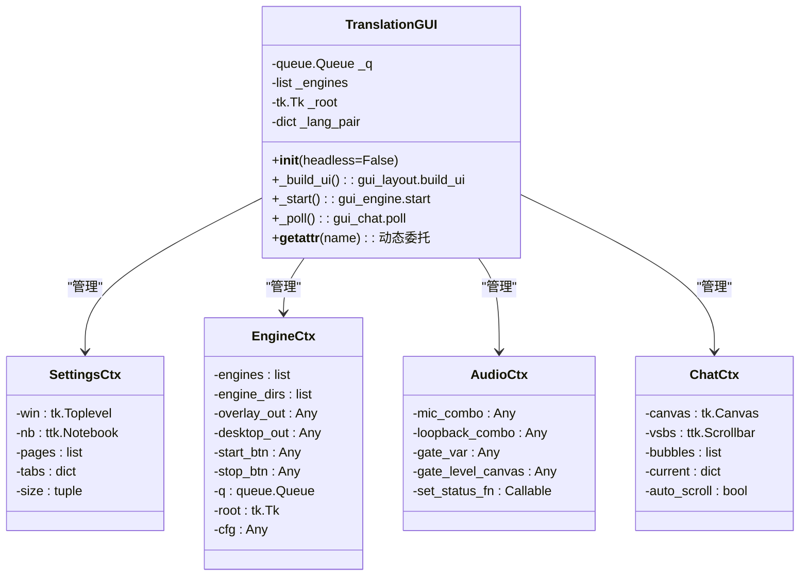
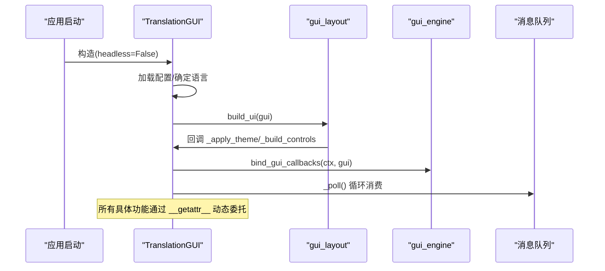
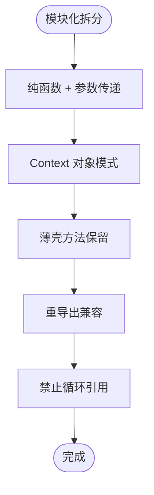
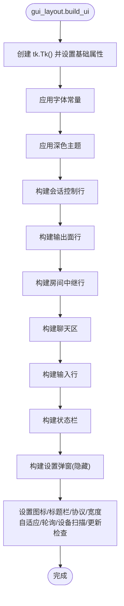
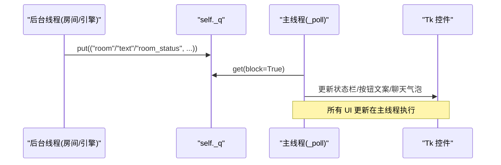
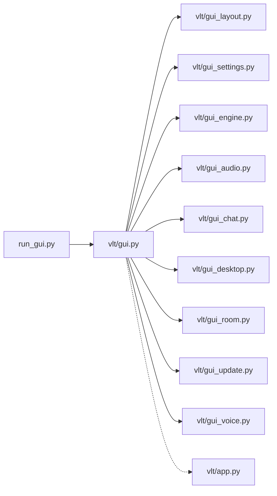

# Tkinter 界面架构

<cite>
**本文引用的文件**   
- [gui.py](file://vlt/gui.py)
- [gui_layout.py](file://vlt/gui_layout.py)
- [gui_settings.py](file://vlt/gui_settings.py)
- [gui_engine.py](file://vlt/gui_engine.py)
- [gui_audio.py](file://vlt/gui_audio.py)
- [gui_chat.py](file://vlt/gui_chat.py)
- [gui_desktop.py](file://vlt/gui_desktop.py)
- [gui_room.py](file://vlt/gui_room.py)
- [gui_update.py](file://vlt/gui_update.py)
- [gui_voice.py](file://vlt/gui_voice.py)
- [ui_tk.py](file://vlt/ui_tk.py)
- [ui_theme.py](file://vlt/ui_theme.py)
- [app.py](file://vlt/app.py)
- [run_gui.py](file://run_gui.py)
</cite>

## 更新摘要
**变更内容**
- 将 gui.py 从单体文件重构为模块化架构，拆分为 10 个功能域子模块
- TranslationGUI 类现在是薄壳控制器，通过委托模式调用各子模块
- 新增上下文对象（Context）模式管理状态和控件引用
- 采用纯函数 + 参数传递模式消除 self 耦合
- 保持向后兼容的重导出机制

## 目录
1. [简介](#简介)
2. [项目结构](#项目结构)
3. [核心组件](#核心组件)
4. [架构总览](#架构总览)
5. [详细组件分析](#详细组件分析)
6. [依赖关系分析](#依赖关系分析)
7. [性能与线程安全](#性能与线程安全)
8. [故障排查指南](#故障排查指南)
9. [结论](#结论)
10. [附录：扩展与自定义指南](#附录扩展与自定义指南)

## 简介
本文面向希望理解或扩展 VRChat 实时同传项目的 Tkinter 图形界面。经过重大重构后，项目采用了模块化架构设计，将原来 5,000+ 行的单体 gui.py 拆分为 10 个独立的功能域模块。文档聚焦以下目标：
- 解释基于 Tkinter 的界面设计模式，包括主窗口初始化、控件层次结构与事件处理机制。
- 详细说明 TranslationGUI 类的薄壳架构设计，包括生命周期管理、状态管理与线程安全处理。
- 阐述模块化架构的设计原则，包括 Context 模式、纯函数设计和委托机制。
- 说明窗口布局策略，包括响应式设计与多语言适配。
- 解释主题系统的应用，包括深色主题实现与样式定制。
- 提供界面扩展点与自定义指南，并总结性能优化技巧与最佳实践。

## 项目结构
本项目采用"业务聚合 + 工具拆分"的组织方式，将 GUI 相关代码按功能域拆分为独立模块：

**图表来源**
- [gui.py:17-34](file://vlt/gui.py#L17-L34)
- [gui_layout.py:1-200](file://vlt/gui_layout.py#L1-L200)
- [gui_settings.py:1-200](file://vlt/gui_settings.py#L1-L200)
- [gui_engine.py:1-200](file://vlt/gui_engine.py#L1-L200)

章节来源
- [gui.py:1-505](file://vlt/gui.py#L1-L505)
- [gui_layout.py:1-254](file://vlt/gui_layout.py#L1-L254)
- [gui_settings.py:1-1018](file://vlt/gui_settings.py#L1-L1018)
- [gui_engine.py:1-679](file://vlt/gui_engine.py#L1-L679)

## 核心组件
- **TranslationGUI**：薄壳控制器，负责组装各模块、维护全局状态、处理生命周期和事件调度。
- **Context 对象**：每个功能域都有对应的 Context 数据类，封装该功能的控件引用和状态。
- **功能域模块**：10 个独立的子模块，每个负责一个特定的功能领域。
- **ui_tk**：Tkinter 工具模块，提供字体解析、字符宽度换算、控件读取等基础功能。
- **ui_theme**：纯数据视觉常量，定义配色、字号、尺寸等视觉规范。

**章节来源**
- [gui.py:121-505](file://vlt/gui.py#L121-L505)
- [gui_layout.py:37-66](file://vlt/gui_layout.py#L37-L66)
- [gui_settings.py:73-86](file://vlt/gui_settings.py#L73-L86)
- [gui_engine.py:35-106](file://vlt/gui_engine.py#L35-L106)

## 架构总览
TranslationGUI 作为 Tk 主窗口的薄壳控制器，遵循"主线程唯一 UI 操作"的原则，采用委托模式将具体功能分发到各个子模块：

**图表来源**
- [gui.py:121-229](file://vlt/gui.py#L121-L229)
- [gui_settings.py:73-86](file://vlt/gui_settings.py#L73-L86)
- [gui_engine.py:35-106](file://vlt/gui_engine.py#L35-L106)
- [gui_audio.py:38-62](file://vlt/gui_audio.py#L38-L62)
- [gui_chat.py:50-108](file://vlt/gui_chat.py#L50-L108)

## 详细组件分析

### TranslationGUI 薄壳架构设计
TranslationGUI 现在是薄壳控制器，主要负责：
- **生命周期管理**：构造时加载配置、确定界面语言、初始化 Context 对象；_build_ui 创建主窗口；_on_close 负责资源回收。
- **状态管理**：维护方向、语言对、输出勾选、房间连接态等全局状态。
- **委托机制**：通过 `_DELEGATE_MAP` 字典将 ~60 个方法动态委托给对应子模块。
- **Context 同步**：在需要时同步 gui 实例属性到 Context 对象，再传递给子模块函数。

**图表来源**
- [gui.py:121-174](file://vlt/gui.py#L121-L174)
- [gui_layout.py:37-66](file://vlt/gui_layout.py#L37-L66)
- [gui_engine.py:135-146](file://vlt/gui_engine.py#L135-L146)

**章节来源**
- [gui.py:121-229](file://vlt/gui.py#L121-L229)

### 模块化架构设计原则
项目采用以下设计原则进行模块化：

1. **纯函数 + 参数传递**：拆出的函数不依赖 self，所有 Tk 控件和状态通过参数显式传入。
2. **Context 对象模式**：每个功能域定义对应的 Context 数据类，封装该功能的控件引用和状态。
3. **薄壳方法保留**：TranslationGUI 中保留同名薄方法，内部委托给拆出的函数（保持测试兼容）。
4. **重导出兼容**：gui.py 通过 `from .gui_xxx import ...` 重导入，外部 `from vlt.gui import XXX` 不变。
5. **禁止循环引用**：新模块不 import vlt.gui，避免循环依赖。

**图表来源**
- [gui.py:17-34](file://vlt/gui.py#L17-L34)
- [gui_layout.py:1-4](file://vlt/gui_layout.py#L1-L4)
- [gui_settings.py:1-14](file://vlt/gui_settings.py#L1-L14)

**章节来源**
- [gui.py:17-34](file://vlt/gui.py#L17-L34)
- [gui_layout.py:1-4](file://vlt/gui_layout.py#L1-L4)
- [gui_settings.py:1-14](file://vlt/gui_settings.py#L1-L14)

### 界面构建流程与依赖关系
_build_ui 现在是 gui_layout.build_ui 的薄壳方法，按固定顺序调用各子构建器：

1. 创建 tk.Tk() 并设置标题、几何尺寸、最小尺寸、背景色。
2. 应用字体与主题（必须先于任何控件创建）。
3. 构建第一行会话控制（开/停、方向、语言对）。
4. 构建第二行输出面（chatbox、手腕屏、译音输出、桌面字幕）。
5. 构建第三行房间中继（连接/断开 + 状态）。
6. 构建聊天区与输入行。
7. 构建状态栏与设置弹窗（先建好再隐藏）。
8. 设置窗口图标、深色标题栏、协议处理、初始宽度自适应、API key 检查、轮询、设备扫描、更新检查调度。

**图表来源**
- [gui_layout.py:37-66](file://vlt/gui_layout.py#L37-L66)

**章节来源**
- [gui_layout.py:37-66](file://vlt/gui_layout.py#L37-L66)

### 窗口布局策略与多语言适配
- **响应式设计**：fit_window_width 根据当前界面语言的实际需求宽度调整窗口初始尺寸与最小宽度。
- **多语言适配**：控件文案通过 i18n.t() 获取；下拉框宽度通过 _combo_width 计算。
- **分割与分组**：使用 1px 深色分割线与 ttk.Separator 表达层次。

**章节来源**
- [gui_layout.py:68-88](file://vlt/gui_layout.py#L68-L88)

### 主题系统与深色主题实现
- **主题应用**：apply_theme 切换 ttk 主题为 clam，统一配置 Frame、Label、Button 等样式。
- **视觉常量**：ui_theme.py 定义 BG/PANEL/SURFACE/BORDER/ACCENT/TEXT 等常量。
- **字体与字号**：ui_tk.py 提供 resolve_ui_family 与 apply_ui_font。

**章节来源**
- [ui_tk.py:173-311](file://vlt/ui_tk.py#L173-L311)
- [ui_theme.py:29-57](file://vlt/ui_theme.py#L29-L57)

### 事件处理机制与线程安全
- **事件绑定**：按钮点击、单选/复选框变化、下拉选择等均绑定到 TranslationGUI 的方法。
- **线程安全**：后台线程通过 self._q 队列投递消息，主线程通过 _poll 消费并更新 UI。
- **防抖与节流**：滑块拖动使用 after 延迟落盘；状态栏文案刷新有节流。

**图表来源**
- [gui.py:464-483](file://vlt/gui.py#L464-L483)

**章节来源**
- [gui.py:464-483](file://vlt/gui.py#L464-L483)

### 设置弹窗与分页滚动
- **分页设计**：常规/音频/手腕屏/桌面字幕/词库/房间/关于，每页独立 Canvas + Frame + Scrollbar。
- **尺寸自适应**：弹窗宽度固定（SETTINGS_WIDTH），高度按页面内容实测并受上限保护。
- **滚轮支持**：弹窗绑定 MouseWheel/Button-4/5，针对 Text/Listbox 特殊处理。

**章节来源**
- [gui_settings.py:90-129](file://vlt/gui_settings.py#L90-L129)

### 手腕屏与桌面字幕微调
- **手腕屏微调**：锚点、位置/旋转、大小/弯曲/透明度、字号、面板高、底板/原文不透明度。
- **桌面字幕微调**：译文字号/原文字号、面板宽高、透明度、拖动解锁。
- **配置写入**：使用 _yaml_set_in_text/_yaml_set_or_create 就地修改 YAML。

**章节来源**
- [gui_desktop.py:94-189](file://vlt/gui_desktop.py#L94-L189)

## 依赖关系分析
- TranslationGUI 依赖各功能域模块提供的工具与常量，但不反向依赖它们（无循环导入）。
- run_gui 作为 PyInstaller 入口，先兜底 stdout/stderr，再导入 vlt.gui.main。
- app.py 展示 Engine 的使用方式，便于理解 GUI 中引擎集成的上下文。

**图表来源**
- [gui.py:17-34](file://vlt/gui.py#L17-L34)

**章节来源**
- [gui.py:17-34](file://vlt/gui.py#L17-L34)

## 性能与线程安全
- **字体测量缓存**：_char_width_for 对字体规格与文本进行缓存。
- **主题应用前置**：apply_theme 在控件创建前调用。
- **队列驱动 UI 更新**：后台线程仅投递消息，主线程消费并更新 UI。
- **防抖落盘**：手腕屏/桌面字幕滑块拖动使用 after 延迟落盘。
- **窗口宽度自适应**：_fit_window_width 仅在启动时计算一次。

**章节来源**
- [gui_layout.py:68-88](file://vlt/gui_layout.py#L68-L88)

## 故障排查指南
- **窗口图标缺失**：set_window_icon 失败只留痕，不影响启动。
- **深色标题栏失败**：_apply_dark_titlebar 在非 Windows 或旧系统上静默跳过。
- **右键菜单失败**：_attach_edit_menu 捕获异常并留痕。
- **房间连接失败**：start_room 捕获异常并重置 _room。

**章节来源**
- [gui_layout.py:91-124](file://vlt/gui_layout.py#L91-L124)
- [gui_room.py:167-185](file://vlt/gui_room.py#L167-L185)

## 结论
TranslationGUI 以 Tkinter 为基础，采用"薄壳控制器 + 功能域模块 + Context 对象"的模块化架构，结合 ui_tk 与 ui_theme 的工具与常量，实现了深色主题、多语言适配、响应式布局与分页设置弹窗。其设计注重用户体验（防裁字、防卡顿、防误操作）与可维护性（纯数据常量、工具拆分、错误降级留痕）。对于扩展者，建议遵循现有模式：新增控件前先确认主题与字体，新增后台任务务必通过队列投递，新增配置项需保持 YAML 注释与键顺序。

## 附录：扩展与自定义指南
- **新增功能域模块**：
  - 创建新的 gui_xxx.py 模块，定义对应的 Context 数据类。
  - 实现纯函数接口，通过参数接收控件引用和状态。
  - 在 TranslationGUI 中添加薄壳方法和委托映射。
- **新增控件**：
  - 在对应构建方法中添加控件，确保 pack 顺序符合"右侧控件先打包"原则。
  - 使用 t() 包裹文案，确保多语言支持。
  - 使用 ui_theme 中的常量定义颜色与尺寸。
- **新增后台任务**：
  - 在后台线程中通过 self._q.put((kind, payload)) 投递消息。
  - 在 _poll 中消费并更新 UI。
- **新增配置项**：
  - 使用 _yaml_set_in_text/_yaml_set_or_create 就地修改 YAML。
  - 同步内存中的 self._cfg。
- **主题定制**：
  - 在 ui_theme.py 中新增常量，并在 ui_tk.py 的 apply_theme 中配置样式。
- **字体与字号**：
  - 使用 ui_tk.apply_ui_font 在控件创建前应用字体。
  - 使用 _char_width_for 计算控件 width。

**章节来源**
- [gui.py:17-34](file://vlt/gui.py#L17-L34)
- [gui_layout.py:167-200](file://vlt/gui_layout.py#L167-L200)
- [ui_tk.py:173-311](file://vlt/ui_tk.py#L173-L311)
- [ui_theme.py:29-57](file://vlt/ui_theme.py#L29-L57)