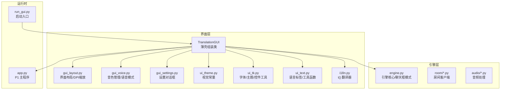
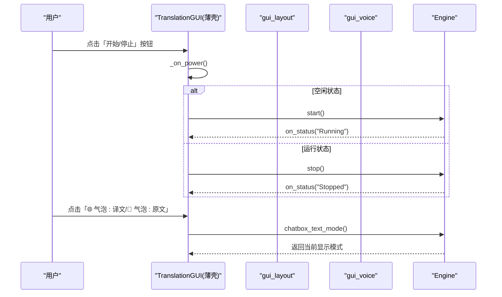
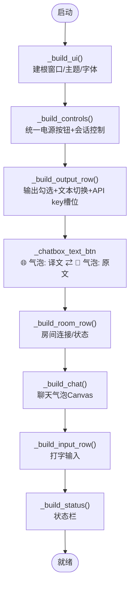
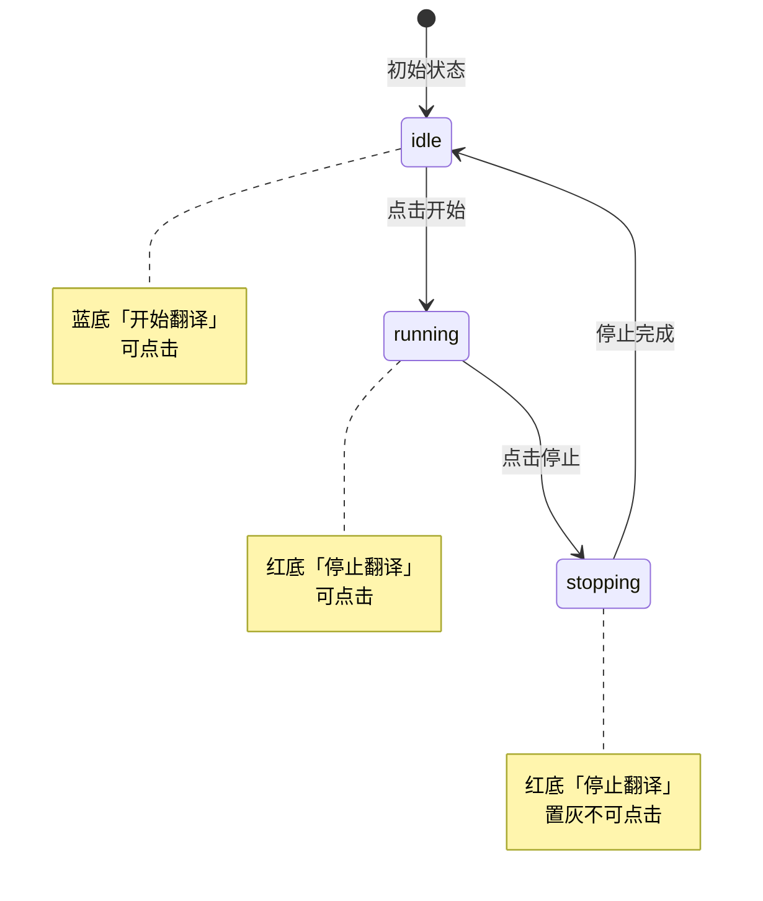
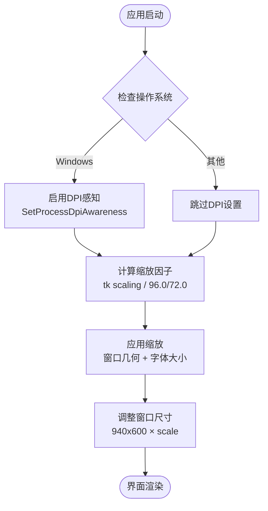
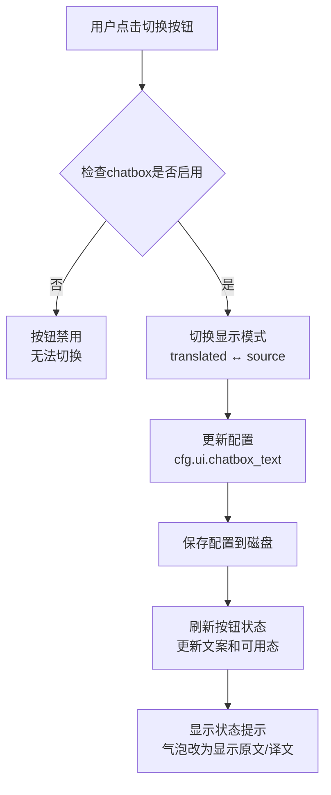
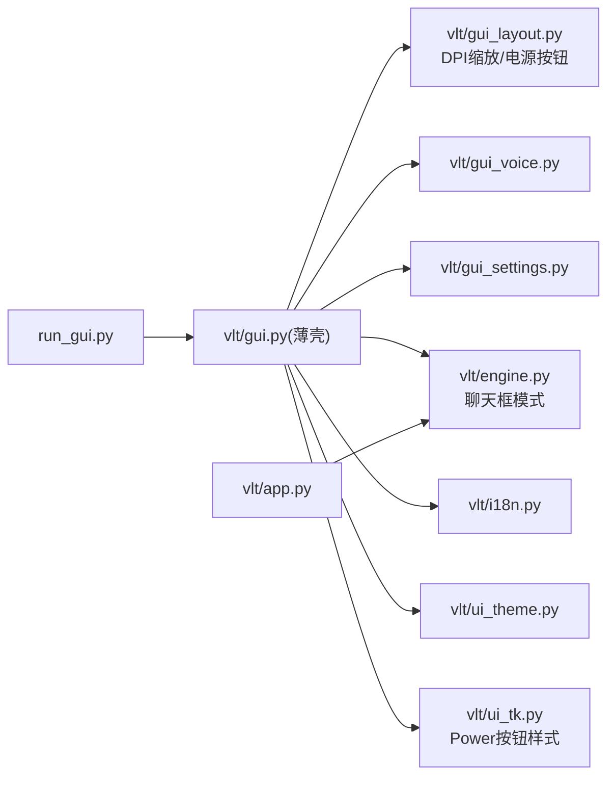

# 图形用户界面

<cite>
**本文引用的文件**   
- [gui.py](file://vlt/gui.py)
- [gui_layout.py](file://vlt/gui_layout.py)
- [gui_voice.py](file://vlt/gui_voice.py)
- [gui_settings.py](file://vlt/gui_settings.py)
- [ui_tk.py](file://vlt/ui_tk.py)
- [engine.py](file://vlt/engine.py)
- [i18n.py](file://vlt/i18n.py)
- [app.py](file://vlt/app.py)
- [run_gui.py](file://run_gui.py)
</cite>

## 更新摘要
**所做更改**   
- 新增了统一的电源切换按钮系统，将开始/停止功能整合为单一控件
- 增强了DPI缩放支持，实现跨平台的高清晰度显示
- 添加了聊天框文本显示切换功能，支持原文/译文实时切换
- 更新了主题系统以支持新的按钮样式和状态管理
- 完善了测试覆盖，确保新功能的行为一致性

## 目录
1. [简介](#简介)
2. [项目结构](#项目结构)
3. [核心组件](#核心组件)
4. [架构总览](#架构总览)
5. [详细组件分析](#详细组件分析)
6. [统一电源切换按钮](#统一电源切换按钮)
7. [DPI缩放与高清晰度支持](#dpi缩放与高清晰度支持)
8. [聊天框文本显示切换](#聊天框文本显示切换)
9. [依赖关系分析](#依赖关系分析)
10. [性能与响应式设计](#性能与响应式设计)
11. [可访问性与无障碍](#可访问性与无障碍)
12. [故障排查指南](#故障排查指南)
13. [结论](#结论)
14. [附录：扩展与自定义指南](#附录扩展与自定义指南)

## 简介
本文件面向基于 Tkinter 的图形用户界面，系统性说明主窗口布局、控件组织、事件处理机制，以及设置对话框、状态监控面板、语言切换器等功能区域的实现。文档还覆盖国际化支持（多语言资源管理、动态语言切换、本地化文本处理）、主题系统与样式定制、用户交互流程与状态管理，并给出界面扩展与自定义指导，同时包含响应式设计与可访问性考虑。

**最新更新**：界面现已支持统一的电源切换按钮、DPI缩放适配和高清晰度显示，以及聊天框文本显示模式切换功能，大幅提升了用户体验和界面可用性。

## 项目结构
界面代码采用模块化架构，通过以下模块解耦：
- `vlt/gui.py`：薄壳组装类，负责模块间协调和入口点
- `vlt/gui_layout.py`：界面布局和控件构建逻辑，包含DPI缩放处理
- `vlt/gui_voice.py`：音色管理和语音模式切换功能
- `vlt/gui_settings.py`：设置对话框各页面构建
- `vlt/ui_tk.py`：需要 Tk 的底层工具（字体族解析、字符宽度换算、控件读取、圆角矩形、主题应用）
- `vlt/engine.py`：引擎核心逻辑，包含聊天框文本模式控制
- `vlt/i18n.py`：多语言系统，以中文原文为 key 的轻量翻译器
- `vlt/app.py`：命令行主程序（音频源→会话→节流合并→chatbox），与 GUI 共享引擎与配置模型

**图表来源** 
- [gui.py:1-498](file://vlt/gui.py#L1-L498)
- [gui_layout.py:1-412](file://vlt/gui_layout.py#L1-L412)
- [engine.py:61-84](file://vlt/engine.py#L61-L84)

**章节来源**
- [gui.py:1-498](file://vlt/gui.py#L1-L498)
- [run_gui.py:1-38](file://run_gui.py#L1-L38)

## 核心组件
- TranslationGUI：薄壳主界面类，负责模块间协调、生命周期管理和委托方法分发
- gui_layout：界面布局构建器，负责主窗口控件组织和布局，包含DPI缩放处理
- gui_voice：音色管理模块，包含语音模式切换、音色选择和词库管理
- gui_settings：设置对话框构建器，按页面组织各种配置选项
- engine.chatbox_text_mode：聊天框文本显示模式控制器，支持原文/译文切换
- i18n.t()：以中文原文为 key 的翻译接口；未命中时回落到中文原文，避免界面崩溃或空白
- ui_theme：集中定义深色主题配色、按钮风格色阶、赞助链接、设置弹窗尺寸常量等
- ui_tk：提供 apply_ui_font、apply_theme、_char_width_for、combo_values、round_rect 等 Tk 相关工具，包含Power按钮样式
- ui_text：提供 _provider_choices、_persist_provider、SOURCE_LANGS/TARGET_LANGS、_Bubble、_DownloadCancelled、_play_pcm_local 等纯逻辑工具
- locales/*：各语言 STRINGS 字典，key 与 t() 调用点逐字一致

**章节来源**
- [gui.py:62-146](file://vlt/gui.py#L62-L146)
- [gui_layout.py:119-154](file://vlt/gui_layout.py#L119-L154)
- [engine.py:61-84](file://vlt/engine.py#L61-L84)

## 架构总览
界面采用"薄壳组装 + 模块化功能"的双层结构：TranslationGUI 作为薄壳类负责模块协调，具体功能分散到独立的 GUI 模块中。所有 UI 构建在各模块的构建函数中完成，主题和字体先于控件创建。事件通过 Tk 的事件循环与队列（self._q）协作，后台线程只入队，主线程统一刷新 UI。

**图表来源**
- [gui.py:347-356](file://vlt/gui.py#L347-L356)
- [gui.py:147-169](file://vlt/gui.py#L147-L169)
- [engine.py:61-84](file://vlt/engine.py#L61-L84)

## 详细组件分析

### 主窗口布局与控件组织
- 第一行（会话控制）：统一的开始/停止按钮、方向（我说/别人说/双向同时）、语言对（源→目标）。
- 第二行（输出面）：chatbox、手腕屏、译音输出、桌面字幕；右上角 API key 状态槽位（已配置显示标签，未配置显示跳转按钮）。
- **新增**：聊天框文本显示切换按钮（🌐 气泡: 译文 ⇄ 📝 气泡: 原文），位于输出行左侧，用于实时切换气泡显示内容。
- 第三行（房间文本中继）：连接/断开按钮 + 状态文案；房间码/昵称在设置弹窗的「房间」页。
- 聊天区：Canvas 上绘制气泡，支持流式刷新、自动滚动、最大气泡数限制。
- 打字输入行：回车发送、Esc 清空，替代麦克风输入。
- 状态栏：运行态、统计信息、错误/警告提示。

**图表来源**
- [gui_layout.py:312-353](file://vlt/gui_layout.py#L312-L353)
- [gui_layout.py:357-412](file://vlt/gui_layout.py#L357-L412)

**章节来源**
- [gui_layout.py:312-353](file://vlt/gui_layout.py#L312-L353)
- [gui_layout.py:357-412](file://vlt/gui_layout.py#L357-L412)
- [gui.py:347-356](file://vlt/gui.py#L347-L356)

## 统一电源切换按钮

### 功能概述
系统将原来的「开始翻译」和「停止翻译」两个独立按钮合并为一个统一的电源切换按钮，提供更好的用户体验和更简洁的界面设计。

### 核心特性
- **单一控件**：一个按钮在「开始翻译」和「停止翻译」两种状态间切换
- **视觉反馈**：蓝色背景表示空闲状态，红色背景表示运行状态
- **状态管理**：idle（空闲）、running（运行中）、stopping（停止中）三态管理
- **尺寸恒定**：使用专门的 Power.TButton 和 PowerDanger.TButton 样式，确保按钮尺寸在状态切换时保持一致

### 实现细节

**图表来源**
- [gui_layout.py:287-310](file://vlt/gui_layout.py#L287-L310)
- [gui.py:347-356](file://vlt/gui.py#L347-L356)

### 样式系统
- **Power.TButton**：蓝色背景，用于空闲状态的「开始翻译」
- **PowerDanger.TButton**：红色背景，用于运行状态的「停止翻译」
- **统一字体和内边距**：使用相同的 `_POWER_FONT` 和 `_POWER_PAD` 常量，确保按钮尺寸不变

**章节来源**
- [gui_layout.py:287-310](file://vlt/gui_layout.py#L287-L310)
- [ui_tk.py:260-280](file://vlt/ui_tk.py#L260-L280)
- [gui.py:347-356](file://vlt/gui.py#L347-L356)

## DPI缩放与高清晰度支持

### 功能概述
新增完整的DPI缩放支持，确保在高清晰度显示器上界面文字清晰锐利，避免模糊问题。

### 核心特性
- **Windows DPI感知**：通过 `SetProcessDpiAwareness` 声明Per-Monitor DPI感知
- **跨平台缩放**：统一的缩放因子计算逻辑，适用于Windows、Linux等平台
- **自适应几何**：窗口尺寸根据缩放因子自动调整，保持界面比例
- **字体缩放**：Tk的tk scaling机制自动放大字号，与几何缩放同步

### 实现机制

**图表来源**
- [gui_layout.py:39-82](file://vlt/gui_layout.py#L39-L82)
- [gui_layout.py:85-116](file://vlt/gui_layout.py#L85-L116)

### 缩放策略
- **自动模式**：跟随系统DPI设置，自动调整界面大小
- **手动模式**：支持 `ui.scale` 配置项，允许用户手动指定缩放比例
- **范围限制**：缩放因子限制在1.0-3.0之间，防止极端情况
- **安全降级**：DPI设置失败时静默回退到默认行为

**章节来源**
- [gui_layout.py:39-82](file://vlt/gui_layout.py#L39-L82)
- [gui_layout.py:85-116](file://vlt/gui_layout.py#L85-L116)
- [gui_layout.py:119-154](file://vlt/gui_layout.py#L119-L154)

## 聊天框文本显示切换

### 功能概述
新增聊天框气泡显示模式的切换功能，用户可以在原文和译文之间实时切换，无需重启应用程序。

### 核心特性
- **实时切换**：点击按钮立即生效，无需重新启动翻译引擎
- **持久化存储**：用户选择保存到配置文件，下次启动时恢复
- **状态同步**：按钮文案和可用状态与实际配置保持同步
- **智能禁用**：当chatbox未启用时，切换按钮自动禁用

### 实现逻辑

**图表来源**
- [gui.py:147-169](file://vlt/gui.py#L147-L169)
- [gui_layout.py:378-388](file://vlt/gui_layout.py#L378-L388)

### 配置管理
- **默认值**：`translated`（显示译文）
- **可选值**：`source`（显示原文）、`translated`（显示译文）
- **验证机制**：脏值自动回落为默认值并记录警告日志
- **即时生效**：每次调用都重新读取配置，不缓存快照

**章节来源**
- [gui.py:147-169](file://vlt/gui.py#L147-L169)
- [engine.py:61-84](file://vlt/engine.py#L61-L84)
- [gui_layout.py:378-388](file://vlt/gui_layout.py#L378-L388)

## 依赖关系分析
- gui.py 依赖：
  - i18n.t：所有可见文案走 t()
  - ui_theme/ui_tk：主题与字体、控件工具
  - ui_text：语言标签、YAML 工具、语音试听、下载取消异常等
  - config/config_io：配置读写、YAML 就地修改
  - engine/devices/output/room：引擎、设备枚举、叠加层、房间客户端
  - paths/platform：路径与平台特性
  - gui_layout：界面布局构建，包含DPI缩放和统一电源按钮
  - gui_voice：语音模式管理
  - gui_settings：设置对话框
- run_gui.py：顶层脚本，兜底 stdout/stderr，拦截 --verify-* 后导入 vlt.gui.main
- app.py：命令行入口，与 GUI 共享 Engine/Config 模型

**图表来源**
- [gui.py:17-44](file://vlt/gui.py#L17-L44)
- [gui_layout.py:1-24](file://vlt/gui_layout.py#L1-L24)
- [engine.py:61-84](file://vlt/engine.py#L61-L84)

**章节来源**
- [gui.py:17-44](file://vlt/gui.py#L17-L44)
- [run_gui.py:1-38](file://run_gui.py#L1-L38)
- [app.py:1-166](file://vlt/app.py#L1-L166)

## 性能与响应式设计
- 字体测量缓存：`_char_width_for` 对字体规格与文本做缓存，避免频繁 measure 导致卡顿
- 窗口宽度自适应：`_fit_window_width` 实测需求宽度，结合屏幕宽度上限调整初始几何与最小尺寸
- **DPI缩放优化**：`_apply_scale` 智能计算和应用缩放因子，支持自动和手动模式
- 设置弹窗尺寸：按内容高度 + 两道上限定高，内容超限时页面滚动兜底
- 滚动条显隐：仅在内容高于可视区域时显示滚动条，保持界面整洁
- 滑块落盘节流：手腕屏/桌面字幕拖动时延时写盘，避免频繁 IO
- **统一电源按钮**：状态切换无闪烁，样式变化平滑过渡
- **聊天框文本切换**：即时生效，无性能开销

**章节来源**
- [gui_layout.py:156-190](file://vlt/gui_layout.py#L156-L190)
- [gui_layout.py:85-116](file://vlt/gui_layout.py#L85-L116)
- [gui.py:347-356](file://vlt/gui.py#L347-L356)

## 可访问性与无障碍
- 右键菜单：为 Entry/Text 绑定剪切/复制/粘贴/全选虚拟事件，解决 Windows 无右键菜单问题
- 键盘导航：回车发送、Esc 清空、Escape 关闭弹窗，默认按钮聚焦
- 颜色对比：深色主题下文本/背景对比度充足，危险动作用独立色系降低误判
- **统一电源按钮**：清晰的视觉反馈，颜色和文案双重提示状态
- **DPI缩放**：确保高清晰度显示，提升可读性
- **聊天框文本切换**：直观的图标和文案标识，状态变化时有明确的视觉反馈
- 图片降级：收款码加载失败降级为文字提示，不抛异常拖垮主窗口
- 状态提示：错误/警告/成功状态栏提示，配合日志留痕，便于辅助技术读取

**章节来源**
- [gui_layout.py:262-283](file://vlt/gui_layout.py#L262-L283)
- [gui_layout.py:287-310](file://vlt/gui_layout.py#L287-L310)
- [gui.py:147-169](file://vlt/gui.py#L147-L169)

## 故障排查指南
- 窗口图标缺失：记录警告但不影响启动
- 标题栏变深色失败：Windows 老系统不支持则静默跳过
- 右键菜单失败：记录警告，不影响输入
- **统一电源按钮问题**：
  - 按钮尺寸不一致：检查是否使用了正确的 Power.TButton/PowerDanger.TButton 样式
  - 状态不同步：确认 `_set_power_state` 是唯一的状态更新入口
  - 点击无响应：检查 `_on_power` 分发逻辑是否正确
- **DPI缩放问题**：
  - 文字模糊：确认已调用 `_enable_windows_dpi_awareness()`
  - 界面过小：检查 `ui.scale` 配置是否正确
  - 窗口尺寸异常：验证缩放因子计算逻辑
- **聊天框文本切换问题**：
  - 按钮禁用：确认chatbox已启用
  - 切换无效：检查配置保存和读取逻辑
  - 显示模式错误：验证 `chatbox_text_mode` 返回值
- 设备扫描失败：提示建议停止翻译后再刷新
- 端口保存失败：就地红字 + 状态栏错误，配置保持原样
- 更新检查失败：自动检查仅留日志；手动检查在设置区显示原因

**章节来源**
- [gui_layout.py:287-310](file://vlt/gui_layout.py#L287-L310)
- [gui_layout.py:39-82](file://vlt/gui_layout.py#L39-L82)
- [gui.py:147-169](file://vlt/gui.py#L147-L169)

## 结论
该图形用户界面经过持续改进，现在提供了更加完善的功能体验：统一的电源切换按钮简化了用户操作，DPI缩放支持确保了高清晰度显示，聊天框文本显示切换功能增强了实用性。系统在模块化架构的基础上，通过 TranslationGUI 薄壳类为核心，围绕 Tkinter 构建了清晰的层次化布局与模块化依赖。新增的功能不仅提升了用户体验，还保持了系统的稳定性和可扩展性。

## 附录：扩展与自定义指南
- 新增语言：
  - 在 `vlt/locales/<code>.py` 新增 STRINGS，key 与现有 t() 调用点逐字一致
  - 在 `i18n._LANGS` 登记 (code, 母语名称)
  - 重启后生效（界面语言切换持久化到 ui.lang）
- 新增设置页：
  - 在 `_build_settings_dialog` 中增加一页 `_settings_page(nb, title)`
  - 在 `_SETTINGS_PAGE_TAB` 登记 page→title 映射，以便 `_open_settings(page=...)` 跳转
- 自定义主题：
  - 修改 `ui_theme.py` 中的配色常量
  - 在 `ui_tk.apply_theme` 中补充 ttk style 映射
- **扩展统一电源按钮**：
  - 修改 `apply_power_state` 函数以支持新的状态
  - 在 `ui_tk.apply_theme` 中添加新的按钮样式
  - 确保新样式使用相同的字体和内边距常量
- **扩展DPI缩放支持**：
  - 修改 `_apply_scale` 函数以支持新的缩放策略
  - 添加平台特定的DPI处理逻辑
  - 更新缩放因子计算和几何适配逻辑
- **扩展聊天框文本显示**：
  - 在 `engine.chatbox_text_mode` 中添加新的显示模式
  - 更新按钮文案生成逻辑
  - 修改配置验证和持久化逻辑
- 响应式优化：
  - 使用 `_fit_window_width` 与 `_size_settings_window` 保证不同语言与屏幕下的可用性
  - 使用 `_sync_page_scrollbar` 控制滚动条显隐

**章节来源**
- [gui_layout.py:287-310](file://vlt/gui_layout.py#L287-L310)
- [gui_layout.py:85-116](file://vlt/gui_layout.py#L85-L116)
- [gui.py:147-169](file://vlt/gui.py#L147-L169)
- [engine.py:61-84](file://vlt/engine.py#L61-L84)
- [ui_tk.py:260-280](file://vlt/ui_tk.py#L260-L280)