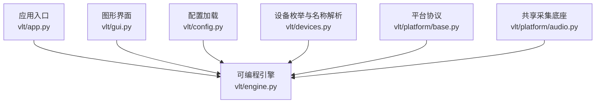
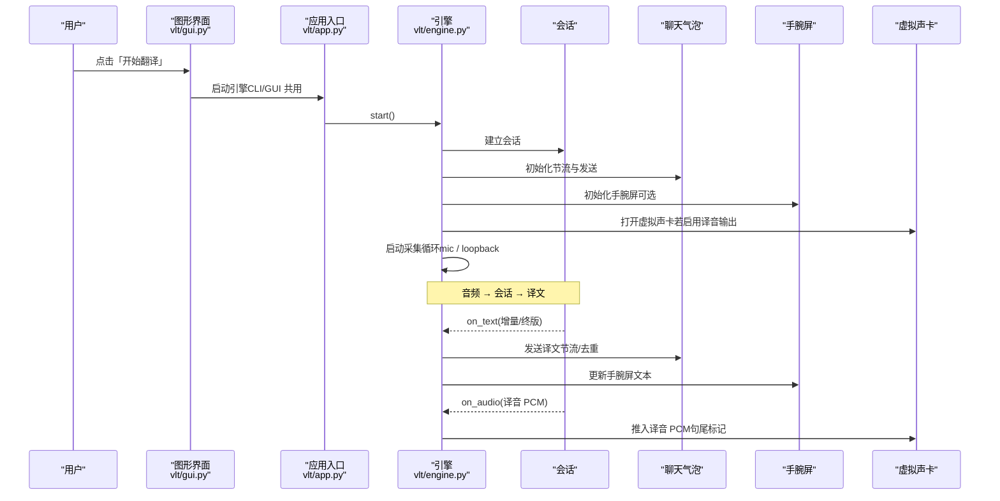
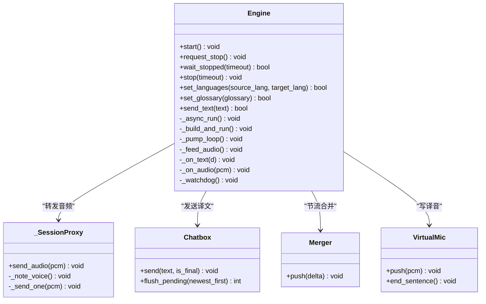
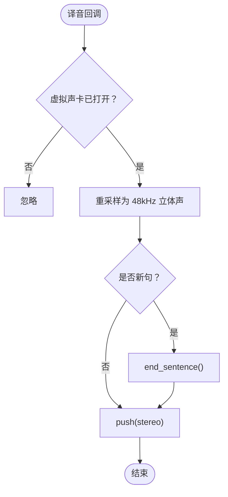
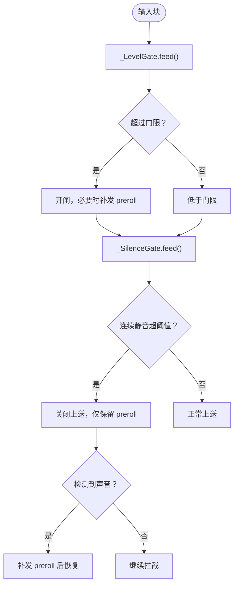
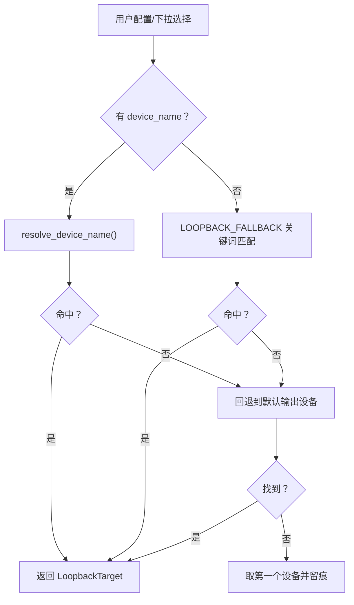
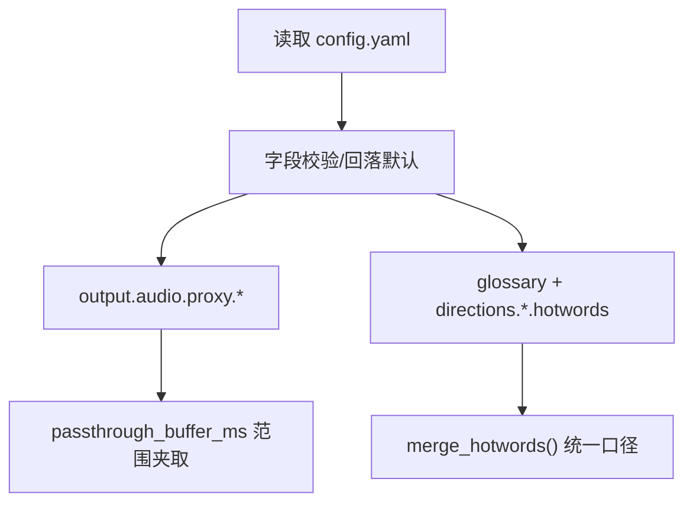
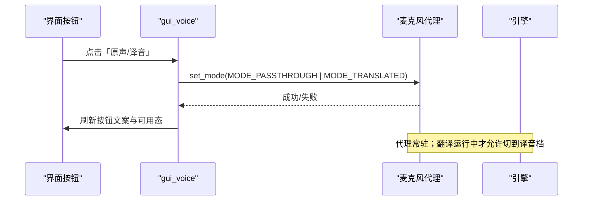
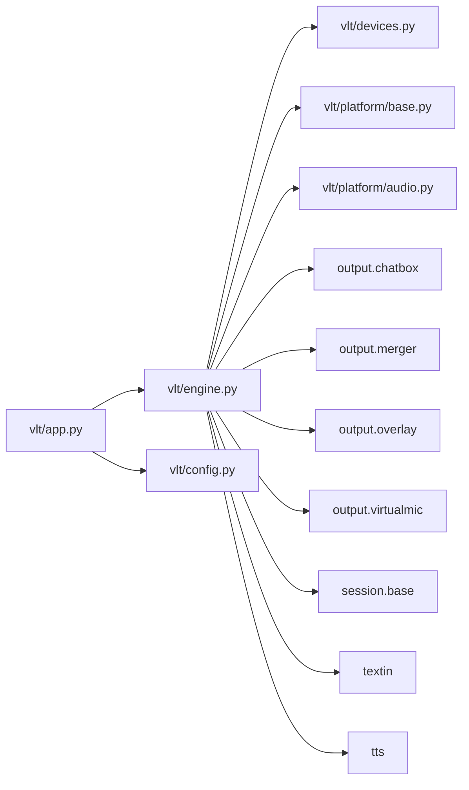

# 麦克风代理系统

<cite>
**本文引用的文件**   
- [README.md](file://README.md)
- [app.py](file://vlt/app.py)
- [engine.py](file://vlt/engine.py)
- [config.py](file://vlt/config.py)
- [devices.py](file://vlt/devices.py)
- [gui.py](file://vlt/gui.py)
- [base.py](file://vlt/platform/base.py)
- [audio.py](file://vlt/platform/audio.py)
</cite>

## 目录
1. [引言](#引言)
2. [项目结构](#项目结构)
3. [核心组件](#核心组件)
4. [架构总览](#架构总览)
5. [详细组件分析](#详细组件分析)
6. [依赖关系分析](#依赖关系分析)
7. [性能与稳定性特性](#性能与稳定性特性)
8. [故障排查指南](#故障排查指南)
9. [结论](#结论)

## 引言
本文件聚焦“麦克风代理系统”：在 VRChat 实时同传中，程序常驻占用虚拟声卡，把麦克风原声或模型译音一键切换输出给游戏；同时负责采集、静音/响度门限、会话重连、聊天气泡与手腕屏输出等。它由图形界面、可插拔引擎、平台抽象层与配置系统共同组成，支持 Windows 与 Linux。

## 项目结构
围绕麦克风代理的相关代码分布在以下模块：
- 应用入口与命令行参数：`vlt/app.py`
- 可编程引擎（音频采集、会话、节流、输出）：`vlt/engine.py`
- 配置加载与默认值校验：`vlt/config.py`
- 设备枚举与名称解析：`vlt/devices.py`
- 图形界面与按钮联动：`vlt/gui.py`
- 平台协议与共享采集底座：`vlt/platform/base.py`、`vlt/platform/audio.py`

**图示来源**
- [app.py:55-107](file://vlt/app.py#L55-L107)
- [engine.py:474-581](file://vlt/engine.py#L474-L581)
- [config.py:275-439](file://vlt/config.py#L275-L439)
- [devices.py:42-165](file://vlt/devices.py#L42-L165)
- [base.py:77-184](file://vlt/platform/base.py#L77-L184)
- [audio.py:30-193](file://vlt/platform/audio.py#L30-L193)

**章节来源**
- [README.md:1-49](file://README.md#L1-L49)
- [app.py:1-166](file://vlt/app.py#L1-L166)
- [engine.py:1-120](file://vlt/engine.py#L1-L120)
- [config.py:1-49](file://vlt/config.py#L1-L49)
- [devices.py:1-23](file://vlt/devices.py#L1-L23)
- [base.py:1-41](file://vlt/platform/base.py#L1-L41)
- [audio.py:1-19](file://vlt/platform/audio.py#L1-L19)

## 核心组件
- 应用入口 `app.py`：解析命令行参数，构造 `EngineEvents`，创建并启动 `Engine`，统计遥测与 token 用量。
- 引擎 `engine.py`：统一封装会话、采集循环、聊天气泡、手腕屏、虚拟声卡、断线重连、重复抑制、输入门限与静音闸门。
- 配置 `config.py`：加载 YAML + 环境变量，提供方向级热词合并、API key 槽位、代理缓冲参数校验与默认值。
- 设备 `devices.py`：把平台原始设备表转成统一 `DeviceInfo`，按名称精确/模糊匹配，避免硬编码索引。
- 平台抽象 `platform/base.py`：定义 `AudioSource`、`AudioSink`、`DeviceBackend`、`CaptureBackend`、`DesktopWindow` 等协议，屏蔽 Windows/Linux 差异。
- 共享采集 `platform/audio.py`：后台线程喂数据到异步队列，统一拉模型；多路混音 `MixedAudioSource`。

**章节来源**
- [app.py:55-107](file://vlt/app.py#L55-L107)
- [engine.py:474-581](file://vlt/engine.py#L474-L581)
- [config.py:107-188](file://vlt/config.py#L107-L188)
- [devices.py:31-165](file://vlt/devices.py#L31-L165)
- [base.py:77-184](file://vlt/platform/base.py#L77-L184)
- [audio.py:30-193](file://vlt/platform/audio.py#L30-L193)

## 架构总览
下图展示从“我说话”到“对方听到译音”的关键路径，以及“别人说话”的 loopback 采集路径。

**图示来源**
- [app.py:55-107](file://vlt/app.py#L55-L107)
- [engine.py:873-941](file://vlt/engine.py#L873-L941)
- [engine.py:1128-1153](file://vlt/engine.py#L1128-L1153)
- [engine.py:1213-1229](file://vlt/engine.py#L1213-L1229)

## 详细组件分析

### 引擎与事件流
- `Engine` 是启停可控的可编程对象：`start()` 非阻塞，内部起守护线程运行 asyncio 事件循环；`stop()` 幂等且带超时；`request_stop()` 立即发信号，适合 UI 并发下发。
- 采集循环通过 `_pump_loop` 定时刷新 chatbox、overlay、session，并通过看门狗自动重连。
- 文本回调 `_on_text` 负责 repeat 抑制、chatbox 投递、overlay 更新；音频回调 `_on_audio` 负责句尾标记与虚拟声卡写入。

**图示来源**
- [engine.py:474-581](file://vlt/engine.py#L474-L581)
- [engine.py:584-636](file://vlt/engine.py#L584-L636)
- [engine.py:873-941](file://vlt/engine.py#L873-L941)
- [engine.py:1128-1153](file://vlt/engine.py#L1128-L1153)
- [engine.py:1213-1229](file://vlt/engine.py#L1213-L1229)

**章节来源**
- [engine.py:474-581](file://vlt/engine.py#L474-L581)
- [engine.py:873-941](file://vlt/engine.py#L873-L941)
- [engine.py:1128-1153](file://vlt/engine.py#L1128-L1153)
- [engine.py:1213-1229](file://vlt/engine.py#L1213-L1229)

### 麦克风代理与虚拟声卡
- 引擎在启用译音输出时调用 `_setup_virtualmic`，可能自建 `VirtualMic`，也可能接受外部注入的 sink（麦克风代理模式）。
- 译音 PCM 经 `_on_audio` 转换为 48kHz 立体声后推入虚拟声卡，并在句子边界调用 `end_sentence()`，让下游整句丢弃逻辑生效。
- 虚拟声卡打开失败只禁用该腿，不影响其它功能。

**图示来源**
- [engine.py:950-980](file://vlt/engine.py#L950-L980)
- [engine.py:1213-1229](file://vlt/engine.py#L1213-L1229)

**章节来源**
- [engine.py:950-980](file://vlt/engine.py#L950-L980)
- [engine.py:1213-1229](file://vlt/engine.py#L1213-L1229)

### 输入门限与静音闸门
- 输入门限 `_LevelGate`：只对 loopback（别人说话）生效，按块 RMS 判断响度，低于阈值不送上送；开闸时补发 preroll，防止丢句首；hold 期防句中断裂。
- 长静音闸门 `_SilenceGate`：连续静音超过阈值暂停上送，保留 preroll，声音恢复时先补发 preroll，再正常上送，缓解服务端 repeat 掉线问题。
- 两者串联工作：前者过滤小声，后者应对长时间真静音。

**图示来源**
- [engine.py:232-295](file://vlt/engine.py#L232-L295)
- [engine.py:297-375](file://vlt/engine.py#L297-L375)
- [engine.py:1527-1548](file://vlt/engine.py#L1527-L1548)

**章节来源**
- [engine.py:232-295](file://vlt/engine.py#L232-L295)
- [engine.py:297-375](file://vlt/engine.py#L297-L375)
- [engine.py:1527-1548](file://vlt/engine.py#L1527-L1548)

### 设备选择与回退链
- `devices.py` 将平台原始设备表转为 `DeviceInfo`，支持 input/output/loopback 三类设备。
- 名称解析顺序：全名精确匹配 → 不区分大小写 → 子串匹配 → 返回 None（交由上层回退链）。
- loopback 目标选择：用户指定 → 关键词回退链 → 默认输出设备对应端点 → 第一个可用设备。

**图示来源**
- [devices.py:109-165](file://vlt/devices.py#L109-L165)
- [engine.py:1670-1734](file://vlt/engine.py#L1670-L1734)

**章节来源**
- [devices.py:42-165](file://vlt/devices.py#L42-L165)
- [engine.py:1670-1734](file://vlt/engine.py#L1670-L1734)

### 配置与代理参数
- 配置加载 `load_config` 负责 YAML + 环境变量，提供 API key 槽位、线路 host 一致性检查、老配置迁移提示。
- 麦克风代理参数：`output.audio.proxy.enabled`、`passthrough_buffer_ms`（下限 150ms，越界夹取）、`hint_shown`（首次提示标记）。
- 方向级热词与全局词库通过 `merge_hotwords` 统一合并，避免两条腿口径不一致。

**图示来源**
- [config.py:275-439](file://vlt/config.py#L275-L439)
- [config.py:107-118](file://vlt/config.py#L107-L118)

**章节来源**
- [config.py:275-439](file://vlt/config.py#L275-L439)
- [config.py:107-118](file://vlt/config.py#L107-L118)

### 图形界面与一键切换
- 主界面通过 `TranslationGUI` 管理多个引擎实例、气泡、手腕屏、桌面字幕与房间广播。
- “原声/译音”按钮状态由 `gui_voice.refresh_voice_mode_btn` 控制：仅在代理可用且翻译运行时可切换。
- 代理生命周期与翻译解耦：程序启动即常驻虚拟声卡路由，翻译启动后自动切到译音档（若开启译音输出）。

**图示来源**
- [gui.py:144-169](file://vlt/gui.py#L144-L169)
- [gui.py:347-407](file://vlt/gui.py#L347-L407)

**章节来源**
- [gui.py:62-104](file://vlt/gui.py#L62-L104)
- [gui.py:144-169](file://vlt/gui.py#L144-L169)
- [gui.py:347-407](file://vlt/gui.py#L347-L407)

## 依赖关系分析
- `app.py` 依赖 `config.load_config`、`engine.Engine` 与 `paths.APP_DIR`。
- `engine.py` 依赖 `config.AppConfig`、`devices`、`platform`、`output.chatbox`、`output.merger`、`output.overlay`、`output.virtualmic`、`session.base`、`textin`、`tts`。
- `platform/base.py` 定义协议，`platform/audio.py` 提供共享采集实现，二者被 `engine.py` 与平台后端使用。
- `devices.py` 通过 `platform.device_backend()` 动态获取设备列表，避免导入耦合。

**图示来源**
- [app.py:23-31](file://vlt/app.py#L23-L31)
- [engine.py:21-39](file://vlt/engine.py#L21-L39)
- [devices.py:26-28](file://vlt/devices.py#L26-L28)
- [base.py:77-184](file://vlt/platform/base.py#L77-L184)
- [audio.py:30-193](file://vlt/platform/audio.py#L30-L193)

**章节来源**
- [app.py:23-31](file://vlt/app.py#L23-L31)
- [engine.py:21-39](file://vlt/engine.py#L21-L39)
- [devices.py:26-28](file://vlt/devices.py#L26-L28)
- [base.py:77-184](file://vlt/platform/base.py#L77-L184)
- [audio.py:30-193](file://vlt/platform/audio.py#L30-L193)

## 性能与稳定性特性
- 采集拉模型：`QueueAudioSource` 后台线程喂数据到异步队列，`read()` 超时返回 None，避免阻塞事件循环。
- 多路混音：`MixedAudioSource` 并发读各路，相加限幅成一路，避免漏音。
- 重采样：`to_16k_mono` 处理任意采样率/声道，修正历史 bug，保证语音质量。
- 断线自愈：看门狗检测会话健康，带退避重连；本地 repeat 抑制主动重建会话。
- 停止流程：`request_stop()` 立即发信号，`wait_stopped()` 等待收尾，避免 UI 卡顿。

**章节来源**
- [audio.py:30-193](file://vlt/platform/audio.py#L30-L193)
- [engine.py:1374-1478](file://vlt/engine.py#L1374-L1478)
- [engine.py:1799-1826](file://vlt/engine.py#L1799-L1826)
- [engine.py:594-636](file://vlt/engine.py#L594-L636)

## 故障排查指南
- 虚拟声卡打不开：引擎会禁用译音输出腿并留痕；检查 `output.audio.enabled` 与设备回退链。
- 别人说话听不清：确认 loopback 目标选择正确（Windows WASAPI loopback / Linux PipeWire VRChat 流），并调整输入门限 `gate_db`。
- 模型重复输出导致掉线：观察本地 repeat 抑制日志，必要时重建会话；检查长静音闸门是否误关。
- 停止后无响应：应使用 `request_stop()` + 后台 `wait_stopped()`，避免直接 `stop()` 阻塞 UI。
- 设备名无效：优先用 `--list-devices` 查看真实 PortAudio 索引，再用名称匹配而非索引。

**章节来源**
- [engine.py:981-1035](file://vlt/engine.py#L981-L1035)
- [engine.py:1670-1734](file://vlt/engine.py#L1670-L1734)
- [engine.py:1158-1198](file://vlt/engine.py#L1158-L1198)
- [engine.py:594-636](file://vlt/engine.py#L594-L636)
- [engine.py:1949-1971](file://vlt/engine.py#L1949-L1971)

## 结论
麦克风代理系统以 `Engine` 为核心，结合 `platform` 抽象层与 `devices` 名称解析，实现了跨平台的麦克风/系统声采集、会话管理、聊天气泡与手腕屏输出，并通过虚拟声卡提供“原声/译音”一键切换。其设计强调健壮性：非法配置留痕回落、断线自动重连、repeat 抑制、输入门限与静音闸门协同，确保在复杂网络与音频环境下稳定运行。