# 测试框架

<cite>
**本文引用的文件**   
- [run_tests.py](file://scripts/run_tests.py)
- [ci.yml](file://.github/workflows/ci.yml)
- [test_run_tests.py](file://tests/test_run_tests.py)
- [test_engine.py](file://tests/test_engine.py)
- [test_config_save.py](file://tests/test_config_save.py)
- [test_devices.py](file://tests/test_devices.py)
- [test_i18n.py](file://tests/test_i18n.py)
- [test_update_check.py](file://tests/test_update_check.py)
- [test_wrap.py](file://tests/test_wrap.py)
- [test_virtualmic.py](file://tests/test_virtualmic.py)
- [test_reconnect.py](file://tests/test_reconnect.py)
- [config_io.py](file://vlt/config_io.py)
- [update_check.py](file://vlt/update_check.py)
- [_node_script.py](file://tests/_node_script.py)
- [test_room_server.py](file://tests/test_room_server.py)
- [test_room_worker_auth.py](file://tests/test_room_worker_auth.py)
</cite>

## 更新摘要
**变更内容**   
- 新增单一权威测试运行器 `scripts/run_tests.py`，统一本地和 CI 测试执行口径
- 实现 tkinter 依赖检测机制，支持 GUI 用例的自动发现和跳过
- 增强 xvfb 虚拟屏管理，确保 Linux 环境下测试一致性
- 完善测试基础设施的门禁机制，防止静默跳过或假绿
- **新增**：`tests/_node_script.py` 工具模块，提供健壮的 Node.js 子进程处理，包含超时处理和重试逻辑
- 更新 CI 配置以使用新的测试运行器

## 目录
1. [简介](#简介)
2. [项目结构](#项目结构)
3. [核心组件](#核心组件)
4. [架构总览](#架构总览)
5. [详细组件分析](#详细组件分析)
6. [依赖关系分析](#依赖关系分析)
7. [性能与稳定性考量](#性能与稳定性考量)
8. [故障排查指南](#故障排查指南)
9. [结论](#结论)
10. [附录：编写高质量测试用例的规范](#附录编写高质量测试用例的规范)

## 简介
本仓库采用"离线优先"的测试策略：所有 CI 可运行的测试不得依赖真实 API Key、麦克风、VRChat/SteamVR 或网络。对外部依赖通过假对象、桩函数、环境变量隔离和临时配置来模拟；对异步流程使用 asyncio 驱动；对状态验证通过事件回调、内部属性断言以及输出产物校验完成。**重大更新**：现在使用统一的 `scripts/run_tests.py` 作为单一权威测试运行器，确保本地开发和 CI 环境的一致性，并支持智能的 tkinter 依赖检测和 xvfb 虚拟屏管理。**新增**：引入了健壮的 Node.js 子进程处理机制，解决了 Windows CI 共享 runner 上的间歇性超时问题。

## 项目结构
测试代码集中在 tests 目录，按功能域组织为独立脚本，每个脚本通常包含一组相关用例和一个可选的 main 入口，便于直接运行或交由 pytest/unittest 发现。**新增**：所有测试现在通过 `scripts/run_tests.py` 统一执行，该运行器负责测试发现、依赖检测、环境准备和结果汇总。**新增**：`tests/_node_script.py` 提供了跨测试共享的 Node.js 子进程处理工具，专门解决 Windows CI 上的稳定性问题。关键测试文件与其职责如下：

- test_engine.py：Engine 生命周期、语言切换与 PCM dry-run（无头）测试
- test_config_save.py：GUI 保存配置时注释与键顺序保护、坏配置恢复
- test_devices.py：设备枚举与名称解析（注入假设备列表）
- test_i18n.py：词表完整性、格式化/回落、系统语言探测委派、英文界面无汉字守卫
- test_update_check.py：更新检查全链路离线测试（HTTP 层用假 opener）
- test_wrap.py：文本换行与渲染回归（整词保护、CJK 逐字断行）
- test_virtualmic.py：虚拟声卡纯逻辑测试（双平台打桩纪律）
- test_reconnect.py：断线自愈与重连、黑匣子诊断
- test_room_server.py：实际 Room 处理器测试（Node.js 子进程）
- test_room_worker_auth.py：Worker 认证测试（Node.js 子进程）
- test_run_tests.py：测试运行器行为守卫，确保运行器本身的行为正确性

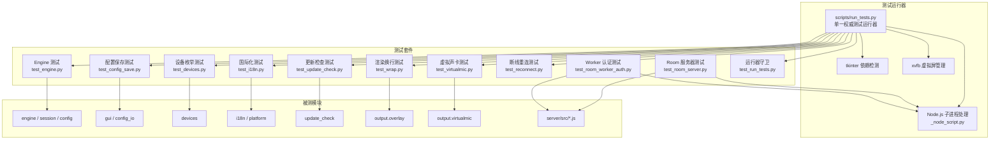

**图表来源**
- [run_tests.py:1-336](file://scripts/run_tests.py#L1-L336)
- [test_run_tests.py:1-262](file://tests/test_run_tests.py#L1-L262)
- [_node_script.py:1-53](file://tests/_node_script.py#L1-L53)

章节来源
- [run_tests.py:1-336](file://scripts/run_tests.py#L1-L336)
- [test_run_tests.py:1-262](file://tests/test_run_tests.py#L1-L262)
- [_node_script.py:1-53](file://tests/_node_script.py#L1-L53)
- [test_engine.py:1-95](file://tests/test_engine.py#L1-L95)
- [test_config_save.py:1-249](file://tests/test_config_save.py#L1-L249)
- [test_devices.py:1-180](file://tests/test_devices.py#L1-L180)
- [test_i18n.py:1-656](file://tests/test_i18n.py#L1-L656)
- [test_update_check.py:1-876](file://tests/test_update_check.py#L1-L876)
- [test_wrap.py:1-133](file://tests/test_wrap.py#L1-L133)
- [test_virtualmic.py:1-501](file://tests/test_virtualmic.py#L1-L501)
- [test_reconnect.py:1-374](file://tests/test_reconnect.py#L1-L374)
- [test_room_server.py:1-57](file://tests/test_room_server.py#L1-L57)
- [test_room_worker_auth.py:1-47](file://tests/test_room_worker_auth.py#L1-L47)

## 核心组件
- **单一权威测试运行器**
  - `scripts/run_tests.py` 成为仓库内唯一的测试运行器，本地和 CI 共用同一套执行逻辑
  - 支持灵活的测试选择：`--only` 参数支持子串匹配和通配符
  - 集成覆盖率统计：`--coverage` 模式累积覆盖率数据并生成摘要
  - 智能依赖检测：自动检测 tkinter 可用性并跳过相关 GUI 测试
- **tkinter 依赖检测机制**
  - 运行时检测 tkinter 是否可用，不可用时自动跳过依赖 GUI 的用例
  - 通过 `scripts/list_display_tests.py` 动态发现传递依赖 tkinter 的测试文件
  - CI 模式下强制要求 tkinter 存在，否则直接失败（`--require-tk`）
- **xvfb 虚拟屏管理**
  - Linux 环境下自动为每个测试用例启动独立的 xvfb 实例
  - 显式设置虚拟屏分辨率（默认 1920x1080x24），避免发行版差异
  - CI 模式下强制要求 xvfb 可用（`--require-xvfb`）
- **Node.js 子进程处理工具**
  - **新增**：`tests/_node_script.py` 提供健壮的 Node.js 子进程执行接口
  - 内置 60 秒超时处理，解决 Windows CI 共享 runner 上的冷启动延迟问题
  - 自动重试机制：超时后重试一次，区分环境抖动和真正故障
  - 统一的错误处理和返回值格式
- **单元测试架构设计**
  - 以功能域划分测试文件，避免跨域耦合；每个用例聚焦单一行为或边界条件。
  - 通过 sys.path.insert 将仓库根加入导入路径，保证测试可在任意工作目录下运行。
  - 多数用例可直接 python 执行，提供 main 聚合入口，便于本地快速回归。
- **命名规范**
  - 测试文件以 test_ 前缀命名，类名以 Test 开头，方法以 test_ 开头，遵循 unittest 约定。
  - 辅助函数以下划线前缀命名，如 _make_cfg、_stub_audio_out、_temp_config 等。
- **模拟与桩**
  - HTTP 层：FakeResp/FakeOpener/MapOpener 替换 urllib 调用，完全离线。
  - 音频/平台：同时桩 Windows 侧 pick_output_device/VirtualMic 与 Linux 侧 platform.open_audio_out，防止真机创建虚拟声卡。
  - GUI/i18n：临时 config.yaml + 钉死 detect_system_language，避免系统语言影响。
- **异步测试**
  - 使用 asyncio.run 驱动协程；对看门狗、会话代理、事件处理进行断言。
- **状态验证**
  - 通过 EngineEvents 回调收集 on_text/on_status；通过内部属性（如 virtualmic.is_opened、session.is_alive）断言；通过输出文件/日志留痕断言。

**章节来源**
- [run_tests.py:1-336](file://scripts/run_tests.py#L1-L336)
- [test_run_tests.py:1-262](file://tests/test_run_tests.py#L1-L262)
- [_node_script.py:1-53](file://tests/_node_script.py#L1-L53)
- [test_engine.py:1-95](file://tests/test_engine.py#L1-L95)
- [test_virtualmic.py:1-501](file://tests/test_virtualmic.py#L1-L501)
- [test_i18n.py:1-656](file://tests/test_i18n.py#L1-L656)
- [test_update_check.py:1-876](file://tests/test_update_check.py#L1-L876)
- [test_reconnect.py:1-374](file://tests/test_reconnect.py#L1-L374)

## 架构总览
CI 流水线现在统一通过 `scripts/run_tests.py` 执行测试，确保本地和 CI 环境的一致性。该运行器负责语法检查、静态检查、凭据扫描、全部离线测试（含覆盖率摘要），并在 Windows/Linux 两端分别执行。Linux 端使用 xvfb 运行 Tk 界面测试，安装中日韩字体以满足离线渲染需求。覆盖率数据在一次 run 中累积，不设置阈值但始终打印缺失行以便定位。

**更新**：CI 配置已简化，Windows 和 Linux 两个 job 现在都使用相同的命令调用 `scripts/run_tests.py --coverage --require-tk --require-xvfb`，消除了之前可能存在的执行逻辑差异。**新增**：Node.js 子进程处理工具为需要实际 Node.js 环境的测试提供了稳定的执行基础。

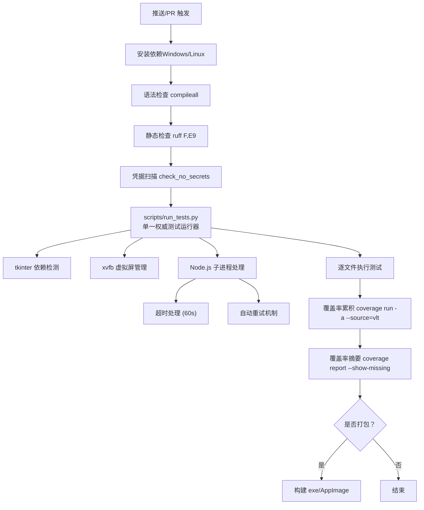

**图表来源**
- [ci.yml:67-77](file://.github/workflows/ci.yml#L67-L77)
- [ci.yml:185-188](file://.github/workflows/ci.yml#L185-L188)
- [run_tests.py:210-331](file://scripts/run_tests.py#L210-L331)
- [_node_script.py:36-52](file://tests/_node_script.py#L36-L52)

章节来源
- [ci.yml:67-77](file://.github/workflows/ci.yml#L67-L77)
- [ci.yml:185-188](file://.github/workflows/ci.yml#L185-L188)
- [run_tests.py:210-331](file://scripts/run_tests.py#L210-L331)
- [_node_script.py:36-52](file://tests/_node_script.py#L36-L52)

## 详细组件分析

### 单一权威测试运行器（scripts/run_tests.py）
**新增**：这是仓库内唯一的测试运行器，负责协调所有测试的执行。

- **核心功能**：
  - 测试发现：自动发现 `tests/test_*.py` 文件并按文件名排序
  - 测试选择：支持 `--only` 参数进行子串匹配或通配符过滤
  - 依赖检测：自动检测 tkinter 可用性，必要时跳过 GUI 相关测试
  - 环境准备：在 Linux 上自动启动 xvfb 虚拟屏
  - 结果汇总：统计 PASS/FAIL/SKIP 数量，提供详细的失败报告
- **命令行接口**：
  - `--only PATTERN`：只运行匹配模式的测试
  - `--with-engine`：包含需要真实 API key 的 engine 测试
  - `--coverage`：启用覆盖率统计
  - `--require-tk`：强制要求 tkinter 可用（CI 模式）
  - `--require-xvfb`：强制要求 xvfb 可用（CI 模式）
  - `--no-xvfb`：禁用 xvfb 自动管理
  - `--xvfb-screen WxHxD`：自定义虚拟屏分辨率

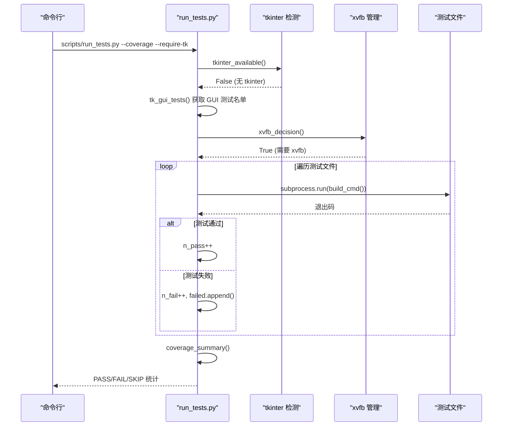

**图表来源**
- [run_tests.py:210-331](file://scripts/run_tests.py#L210-L331)

章节来源
- [run_tests.py:1-336](file://scripts/run_tests.py#L1-L336)

### tkinter 依赖检测机制
**新增**：智能的 tkinter 依赖检测，确保 GUI 测试的正确执行。

- **检测逻辑**：
  - 运行时尝试 import tkinter，捕获任何异常
  - 如果 tkinter 不可用且启用了 `--require-tk`，立即返回错误码 3
  - 否则通过 `scripts/list_display_tests.py` 动态发现依赖 tkinter 的测试文件
  - 对这些测试文件进行跳过，并记录跳过原因
- **安全保障**：
  - 防止静默跳过：如果没有检测到任何 GUI 测试，说明依赖图解析器可能有问题，拒绝继续执行
  - 明确的错误信息：当 tkinter 缺失时，提供清晰的安装指导
  - CI 门禁：在 CI 环境中，缺少 tkinter 直接导致构建失败

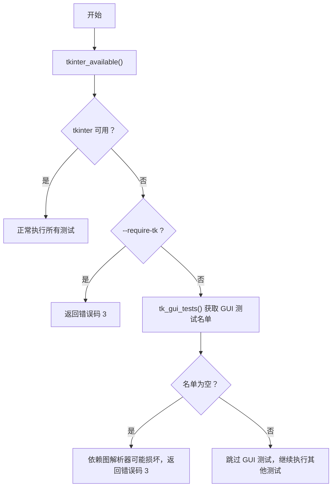

**图表来源**
- [run_tests.py:100-124](file://scripts/run_tests.py#L100-L124)
- [run_tests.py:238-257](file://scripts/run_tests.py#L238-L257)

章节来源
- [run_tests.py:100-124](file://scripts/run_tests.py#L100-L124)
- [run_tests.py:238-257](file://scripts/run_tests.py#L238-L257)

### xvfb 虚拟屏管理
**新增**：Linux 环境下的虚拟屏管理，确保 GUI 测试的一致性和可靠性。

- **决策逻辑**：
  - 仅在 Linux 平台上启用 xvfb
  - 检查 xvfb-run 是否可用，不可用时根据 `--require-xvfb` 参数决定行为
  - 显式设置虚拟屏分辨率为 1920x1080x24（可通过 `VLT_XVFB_SCREEN` 环境变量覆盖）
  - 为每个测试用例启动独立的 xvfb 实例，避免窗口管理器干扰
- **平台差异处理**：
  - Windows/macOS：自带桌面会话，不需要 xvfb
  - Linux：GitHub Actions runner 没有显示器，必须使用 xvfb
  - 本机 Linux：如果找不到 xvfb-run，提供警告但不阻止执行（除非启用 `--require-xvfb`）

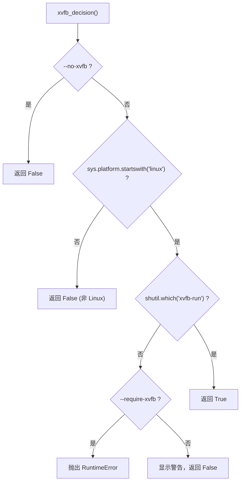

**图表来源**
- [run_tests.py:127-153](file://scripts/run_tests.py#L127-L153)

章节来源
- [run_tests.py:127-153](file://scripts/run_tests.py#L127-L153)

### Node.js 子进程处理工具（tests/_node_script.py）
**新增**：健壮的 Node.js 子进程处理工具，专门解决 Windows CI 共享 runner 上的间歇性超时问题。

- **核心功能**：
  - 统一的 Node.js 子进程执行接口：`run_node(script, uri)`
  - 智能超时处理：默认 60 秒超时，适应 Windows CI 上的 Node.js 冷启动延迟
  - 自动重试机制：超时后重试一次，区分环境抖动和真正故障
  - 标准化的错误处理和返回值格式
- **设计原理**：
  - Windows CI 共享 runner 上 Node.js 冷启动可能因 Defender 扫描、磁盘 IO、机器负载等因素拖到 10 秒以上
  - 原 10 秒超时太紧，导致测试假红（脚本还没开始执行就超时）
  - 通过宽超时 + 重试机制，既保证了稳定性，又不会掩盖真正的故障
- **使用方式**：
  - 调用方需先检查 Node.js 是否可用：`unittest.skipUnless(shutil.which('node'), ...)`
  - 传入 JavaScript 脚本字符串和目标 URI（作为 JSON 字符串）
  - 返回标准的 `subprocess.CompletedProcess` 对象

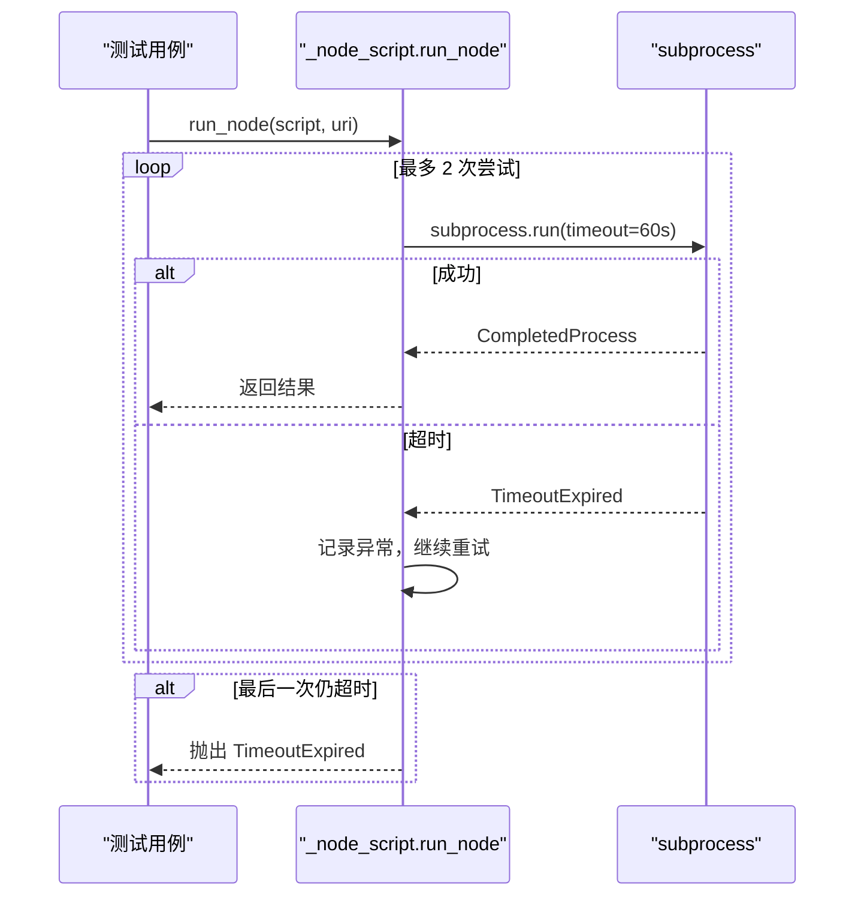

**图表来源**
- [_node_script.py:36-52](file://tests/_node_script.py#L36-L52)

章节来源
- [_node_script.py:1-53](file://tests/_node_script.py#L1-L53)

### Engine 与 Session 测试（生命周期、语言切换、dry-run）
- 目标：验证 Engine 构造、stop 幂等、set_languages 在无会话时的行为，以及 PCM dry-run 完整生命周期。
- 关键点：
  - 通过 EngineEvents 回调捕获 on_text/on_status，验证输出。
  - 使用 pcm 输入源进行 dry-run，无需真实采集。
  - 预算检查仅在需要重建会话时生效，无会话时只改配置。

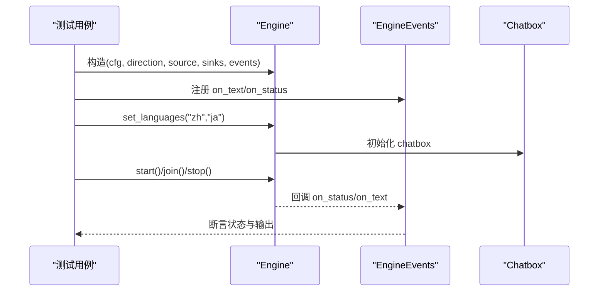

**图表来源**
- [test_engine.py:19-84](file://tests/test_engine.py#L19-L84)

章节来源
- [test_engine.py:1-95](file://tests/test_engine.py#L1-L95)

### 配置保存与 YAML 就地写入（注释与键顺序保护）
- 目标：确保 GUI 保存配置不会破坏 config.yaml 的注释与键顺序；非法 YAML 被拒绝；坏配置自动备份并重建。
- 关键点：
  - 使用 _yaml_set_in_text/_yaml_set_or_create/_write_config_text 实现就地修改与写前校验。
  - 通过 n_comments/top_keys 断言注释行数与顶层键顺序不变。
  - 覆盖块序列值替换、深层缩进注释保留、非法 YAML 拦截、坏配置恢复。

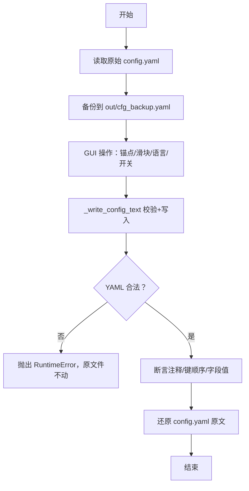

**图表来源**
- [test_config_save.py:43-147](file://tests/test_config_save.py#L43-L147)
- [config_io.py:273-283](file://vlt/config_io.py#L273-L283)

章节来源
- [test_config_save.py:1-249](file://tests/test_config_save.py#L1-L249)
- [config_io.py:273-301](file://vlt/config_io.py#L273-L301)

### 设备枚举与名称解析（注入假设备）
- 目标：验证 resolve_device_name/format_device_display/枚举函数在不同匹配模式下的行为。
- 关键点：
  - 使用 FAKE_SD_DEVICES/FAKE_LOOPBACK_DEVICES 注入假设备列表，无需真实硬件。
  - 覆盖大小写不敏感、子串匹配、特殊字符、空输入、loopback 匹配等场景。

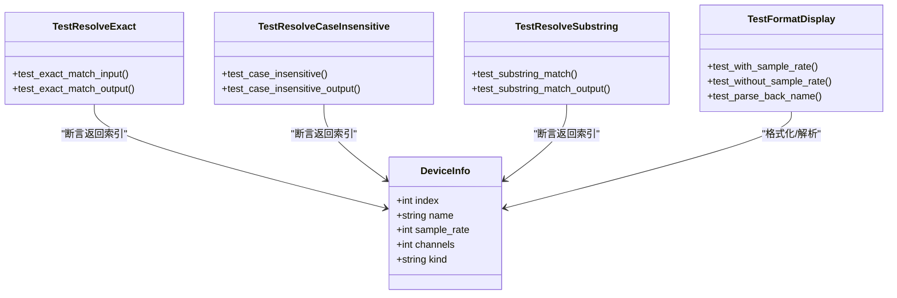

**图表来源**
- [test_devices.py:37-141](file://tests/test_devices.py#L37-L141)

章节来源
- [test_devices.py:1-180](file://tests/test_devices.py#L1-L180)

### 国际化（i18n）：词表完整性、格式化/回落、系统语言委派、英文界面无汉字
- 目标：机械守卫扫描 t("字面量")，确保每套词表齐全；格式化失败不抛异常；未知 key 回落中文；系统语言探测委派给 platform.detect_ui_language；英文界面下无汉字。
- 关键点：
  - AST 扫描 vlt/**/*.py 中的 t() 调用，对比 en/ja/ko/ru 词表 STRINGS。
  - normalize_language 容错；available_languages 固定顺序与母语写法。
  - 使用临时 config.yaml 起真窗口，递归遍历控件 text/title，断言书写系统。
  - 方向下拉的语言名必须翻译且可反查语言码。

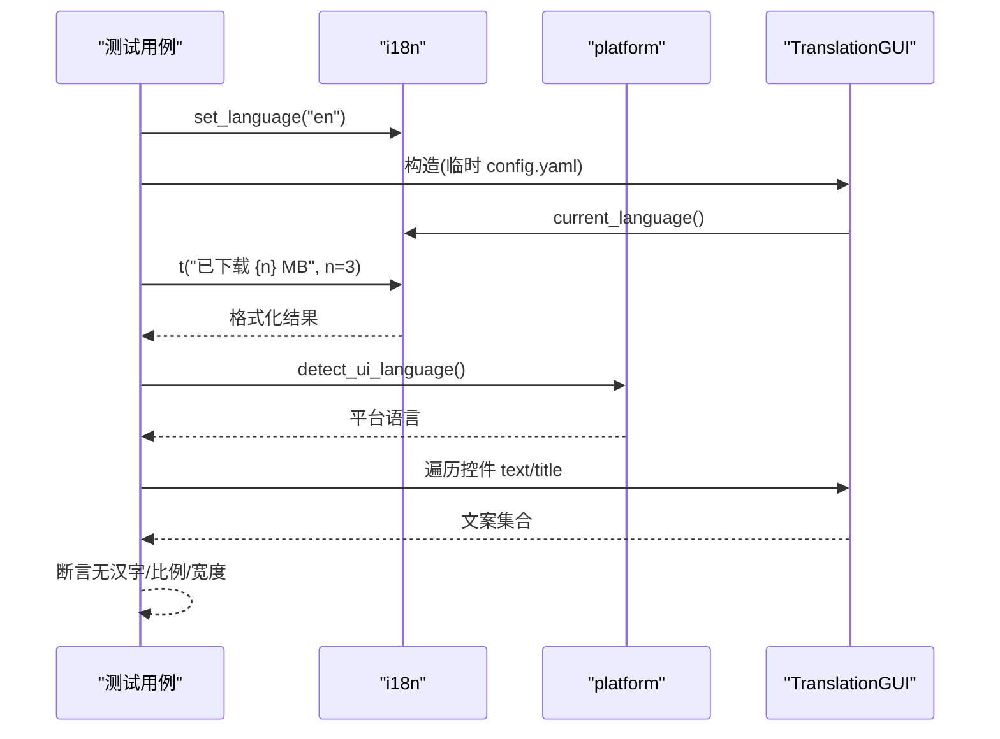

**图表来源**
- [test_i18n.py:119-173](file://tests/test_i18n.py#L119-L173)
- [test_i18n.py:178-241](file://tests/test_i18n.py#L178-L241)
- [test_i18n.py:302-461](file://tests/test_i18n.py#L302-L461)
- [test_i18n.py:467-566](file://tests/test_i18n.py#L467-L566)

章节来源
- [test_i18n.py:1-656](file://tests/test_i18n.py#L1-L656)

### 更新检查（update_check）：离线测试全链路
- 目标：版本解析、拉取 Release、忽略列表读写、决策入口、下载+SHA256+白名单、运行形态判定、AppImage 安装、bat 生成、pending 残留清理。
- 关键点：
  - FakeResp/FakeOpener/MapOpener 替换 _opener，全程离线。
  - 断言 User-Agent、限流/断网错误提示、digest/sums 兜底。
  - update_mode/can_self_update/asset_name_for/update_target_path 多形态判定。
  - install_appimage 在 POSIX/Windows 的行为差异与权限检查。
  - build_updater_bat 生成带重试与清理变量的 bat 脚本。

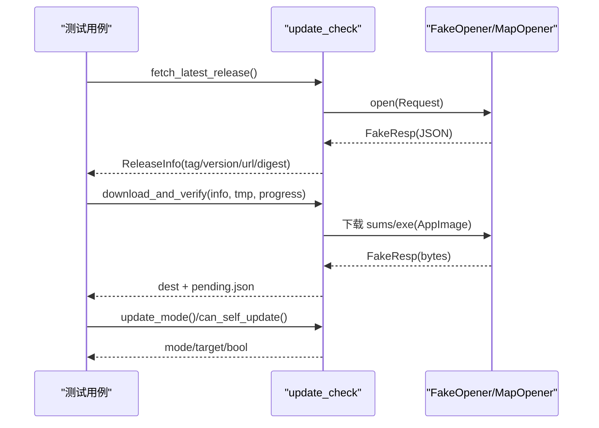

**图表来源**
- [test_update_check.py:42-91](file://tests/test_update_check.py#L42-L91)
- [test_update_check.py:147-235](file://tests/test_update_check.py#L147-L235)
- [test_update_check.py:342-453](file://tests/test_update_check.py#L342-L453)
- [test_update_check.py:484-564](file://tests/test_update_check.py#L484-L564)
- [test_update_check.py:567-633](file://tests/test_update_check.py#L567-L633)
- [test_update_check.py:639-692](file://tests/test_update_check.py#L639-L692)

章节来源
- [test_update_check.py:1-876](file://tests/test_update_check.py#L1-L876)
- [update_check.py:443-479](file://vlt/update_check.py#L443-L479)

### 渲染换行（wrap）：整词保护与 CJK 逐字断行
- 目标：拉丁/西里尔/希腊/韩文整词保护；中文避头尾；CJK 逐字断行；超长单词硬切；渲染尺寸正确。
- 关键点：
  - 独立于被测实现的 _is_cjk_char/_words_of 抽词，避免实现退化导致测试失效。
  - 断言每行长度不超过 MAX_W；render_panel 尺寸与 OverlayConfig.size_px 一致。

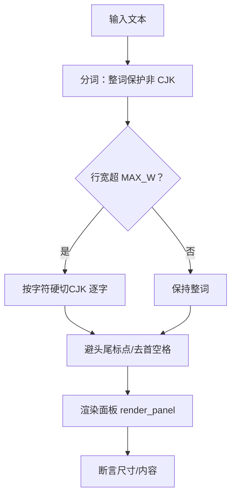

**图表来源**
- [test_wrap.py:24-46](file://tests/test_wrap.py#L24-L46)
- [test_wrap.py:70-128](file://tests/test_wrap.py#L70-L128)

章节来源
- [test_wrap.py:1-133](file://tests/test_wrap.py#L1-L133)

### 虚拟声卡（VirtualMic）：纯逻辑与双平台打桩
- 目标：采样率转换、设备选择、缓冲溢出策略、短译音兜底、打开成功/失败分支、引擎句尾标记。
- 关键点：
  - _stub_audio_out 同时桩 Windows 与 Linux 侧，防止真机创建虚拟声卡。
  - 使用真实类的子类仅替换 open()，暴露属性名写错等回归。
  - 断言 push/end_sentence/close 行为与缓冲上限、正在播放句子不被丢弃。

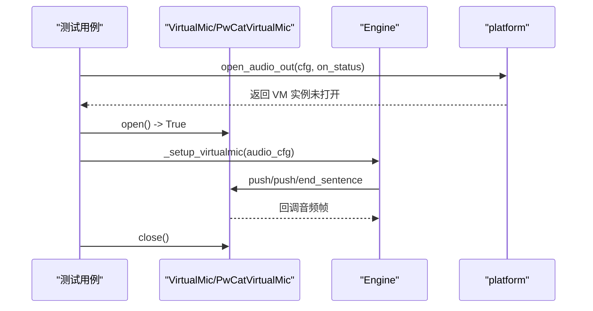

**图表来源**
- [test_virtualmic.py:34-57](file://tests/test_virtualmic.py#L34-L57)
- [test_virtualmic.py:244-319](file://tests/test_virtualmic.py#L244-L319)
- [test_virtualmic.py:413-480](file://tests/test_virtualmic.py#L413-L480)

章节来源
- [test_virtualmic.py:1-501](file://tests/test_virtualmic.py#L1-L501)

### 断线重连（reconnect）：看门狗与会话代理
- 目标：会话不健康自动重连；代理转发到当前会话；发送失败不死循环；断线黑匣子；致命 error 主动放弃。
- 关键点：
  - _FakeSession 可控 alive/fail_reason/received/closed。
  - _watchdog 安排重连任务；_proxy.send_audio 吞掉单次失败并计数。
  - is_fatal_server_error 分类矩阵；_abort_on_fatal 幂等与事件循环外安全。

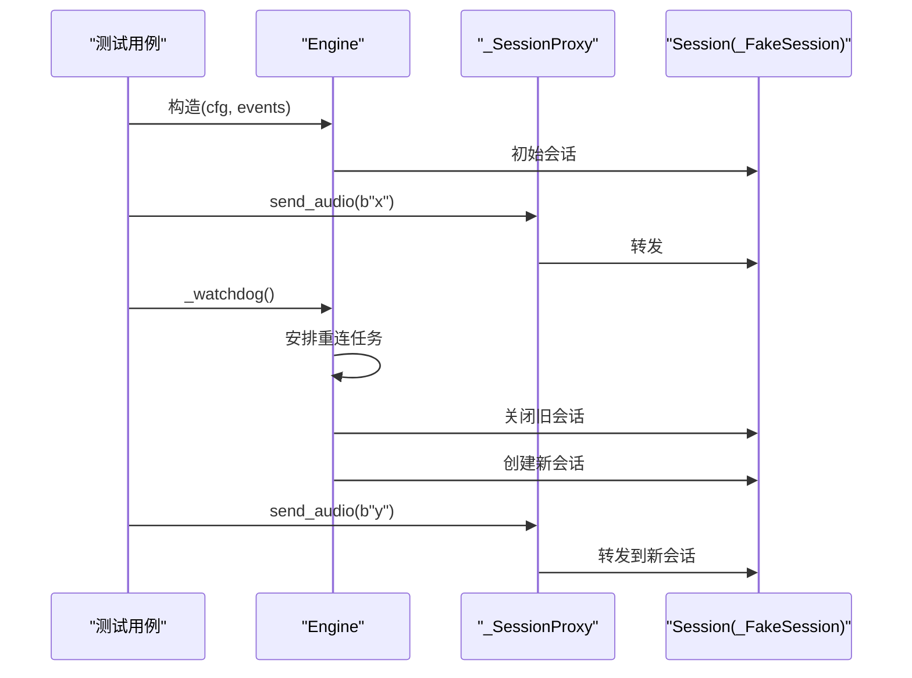

**图表来源**
- [test_reconnect.py:68-87](file://tests/test_reconnect.py#L68-L87)
- [test_reconnect.py:90-126](file://tests/test_reconnect.py#L90-L126)
- [test_reconnect.py:201-251](file://tests/test_reconnect.py#L201-L251)
- [test_reconnect.py:257-328](file://tests/test_reconnect.py#L257-L328)

章节来源
- [test_reconnect.py:1-374](file://tests/test_reconnect.py#L1-L374)

### Room 服务器测试（Node.js 子进程）
**新增**：使用实际的 Node.js 子进程执行 Room 处理器测试，验证 UTF-8 限制和速率限制。

- **测试目标**：
  - 验证实际的 Room 处理器而非重写版本
  - UTF-8 数据包大小限制（5000 字符）
  - 总入站速率限制（每秒 30 条消息）
  - 无效 UTF-8 数据处理
- **Node.js 子进程处理**：
  - 使用 `_node_script.run_node()` 执行 JavaScript 测试脚本
  - 自动处理超时和重试，避免 Windows CI 上的间歇性失败
  - 通过 URI 参数加载实际的 `server/src/room.js` 模块
- **测试场景**：
  - UTF-8 数据包大小限制验证
  - 不同消息类型的速率限制
  - 无效 UTF-8 字节序列处理
  - 有效 UTF-8 数据包持续工作验证

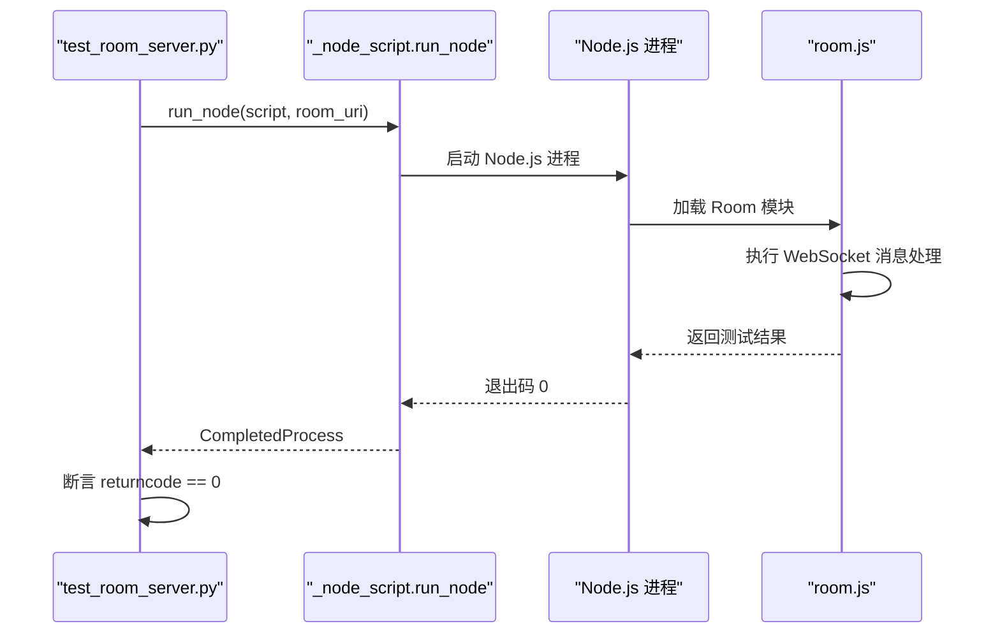

**图表来源**
- [test_room_server.py:11-52](file://tests/test_room_server.py#L11-L52)
- [_node_script.py:36-52](file://tests/_node_script.py#L36-L52)

章节来源
- [test_room_server.py:1-57](file://tests/test_room_server.py#L1-L57)
- [_node_script.py:1-53](file://tests/_node_script.py#L1-L53)

### Worker 认证测试（Node.js 子进程）
**新增**：使用实际的 Node.js 子进程执行 Worker 认证测试，验证 UTF-8 token 支持和恶意数据拒绝。

- **测试目标**：
  - 验证实际的 Cloudflare Worker 认证逻辑
  - UTF-8 token 支持（包括合成令牌和 Unicode 字符）
  - 恶意请求头和查询参数的拒绝
  - 认证错误响应不包含敏感信息
- **Node.js 子进程处理**：
  - 使用 `_node_script.run_node()` 执行 JavaScript 测试脚本
  - 自动处理超时和重试，确保 Windows CI 稳定性
  - 通过 URI 参数加载实际的 `server/src/index.js` 模块
- **测试场景**：
  - 合法 token 的认证成功
  - 恶意 token 的认证失败
  - 查询参数中的敏感信息泄露防护
  - 不同认证头的兼容性

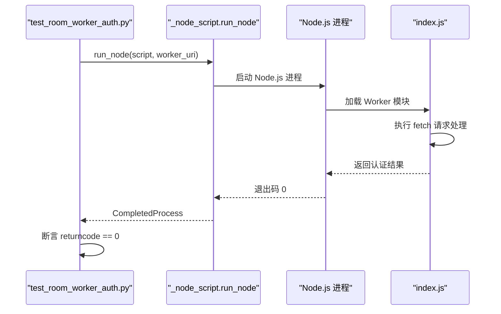

**图表来源**
- [test_room_worker_auth.py:11-42](file://tests/test_room_worker_auth.py#L11-L42)
- [_node_script.py:36-52](file://tests/_node_script.py#L36-L52)

章节来源
- [test_room_worker_auth.py:1-47](file://tests/test_room_worker_auth.py#L1-L47)
- [_node_script.py:1-53](file://tests/_node_script.py#L1-L53)

## 依赖关系分析
- **测试与模块耦合**
  - Engine 测试依赖 config/engine/session；虚拟声卡测试依赖 output.virtualmic 与 platform；更新检查测试依赖 update_check；国际化测试依赖 i18n/platform/gui。
  - **新增**：Room 服务器和 Worker 认证测试依赖 Node.js 环境和实际的 server/src/*.js 模块。
- **外部依赖模拟**
  - HTTP：FakeResp/FakeOpener/MapOpener 替代 urllib.request。
  - 音频：Windows 桩 pick_output_device/VirtualMic；Linux 桩 platform.open_audio_out。
  - GUI：临时 config.yaml + 钉死 detect_system_language。
  - **新增**：Node.js 子进程通过 `_node_script.run_node()` 统一管理，避免分散的子进程处理逻辑。
- **潜在循环依赖**
  - 测试通过 sys.path.insert 引入 vlt，避免相对导入导致的循环；模块间通过明确接口（EngineEvents、ReleaseInfo、DeviceInfo）解耦。
- **测试运行器依赖**
  - `scripts/run_tests.py` 依赖 `scripts/list_display_tests.py` 进行 tkinter 依赖检测
  - CI 配置现在统一依赖 `scripts/run_tests.py`，消除了之前的分散执行逻辑
  - **新增**：Node.js 相关测试依赖 `tests/_node_script.py` 工具模块

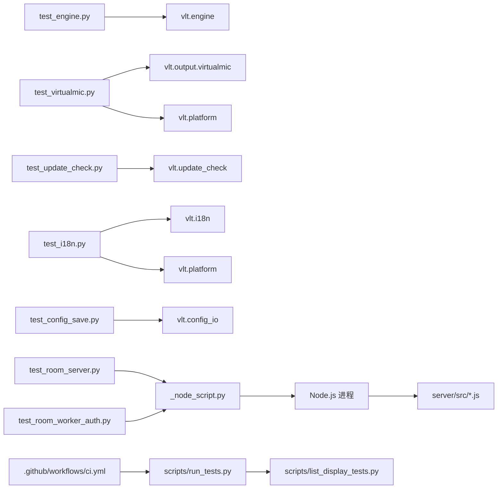

**图表来源**
- [test_engine.py:1-95](file://tests/test_engine.py#L1-L95)
- [test_virtualmic.py:1-501](file://tests/test_virtualmic.py#L1-L501)
- [test_update_check.py:1-876](file://tests/test_update_check.py#L1-L876)
- [test_i18n.py:1-656](file://tests/test_i18n.py#L1-L656)
- [test_config_save.py:1-249](file://tests/test_config_save.py#L1-L249)
- [test_room_server.py:1-57](file://tests/test_room_server.py#L1-L57)
- [test_room_worker_auth.py:1-47](file://tests/test_room_worker_auth.py#L1-L47)
- [_node_script.py:1-53](file://tests/_node_script.py#L1-L53)
- [run_tests.py:109-124](file://scripts/run_tests.py#L109-L124)
- [ci.yml:72-77](file://.github/workflows/ci.yml#L72-L77)

章节来源
- [test_engine.py:1-95](file://tests/test_engine.py#L1-L95)
- [test_virtualmic.py:1-501](file://tests/test_virtualmic.py#L1-L501)
- [test_update_check.py:1-876](file://tests/test_update_check.py#L1-L876)
- [test_i18n.py:1-656](file://tests/test_i18n.py#L1-L656)
- [test_config_save.py:1-249](file://tests/test_config_save.py#L1-L249)
- [test_room_server.py:1-57](file://tests/test_room_server.py#L1-L57)
- [test_room_worker_auth.py:1-47](file://tests/test_room_worker_auth.py#L1-L47)
- [_node_script.py:1-53](file://tests/_node_script.py#L1-L53)
- [run_tests.py:109-124](file://scripts/run_tests.py#L109-L124)
- [ci.yml:72-77](file://.github/workflows/ci.yml#L72-L77)

## 性能与稳定性考量
- **测试执行效率**
  - CI 中一次性 coverage run -a 累积覆盖率，避免重复跑测。
  - 跳过需要真实 API Key 的用例（如 test_engine.py 在 CI 中被显式跳过），减少不稳定因素。
  - 单一测试运行器减少了环境配置差异带来的性能波动。
  - **新增**：Node.js 子进程处理工具通过超时和重试机制，显著提升了 Windows CI 上的测试稳定性。
- **稳定性保障**
  - 静态检查（ruff F,E9）阻断 NameError 等静默降级问题。
  - 凭据扫描防止 key 进入历史。
  - 平台隔离断言（Windows 产物不含 Linux 独占实现）。
  - **新增**：tkinter 和 xvfb 依赖检测防止静默跳过 GUI 测试。
  - **新增**：PASS=0 检测防止所有测试都被跳过时仍然显示绿色。
  - **新增**：Node.js 子进程的 60 秒超时和自动重试机制，解决 Windows CI 共享 runner 上的间歇性超时问题。
- **一致性保证**
  - 本地和 CI 使用完全相同的测试执行逻辑，消除环境差异。
  - 虚拟屏分辨率显式设置为 1920x1080x24，避免不同发行版的默认值差异。
  - **新增**：统一的 Node.js 子进程处理接口，确保所有 Node.js 相关测试具有一致的超时和重试行为。

**章节来源**
- [ci.yml:45-91](file://.github/workflows/ci.yml#L45-L91)
- [ci.yml:177-241](file://.github/workflows/ci.yml#L177-L241)
- [run_tests.py:325-331](file://scripts/run_tests.py#L325-L331)
- [_node_script.py:30-33](file://tests/_node_script.py#L30-L33)

## 故障排查指南
- **常见问题与定位**
  - 配置保存后注释丢失/键顺序变化：检查 _yaml_set_in_text/_yaml_set_or_create 是否误删深层注释；确认 _write_config_text 校验通过。
  - 英文界面出现汉字：检查 t() 调用是否遗漏词条；确认 UI 控件 text/title 未被排除路径漏扫。
  - 虚拟声卡未打开：确认双平台桩均生效；查看 on_status(error) 消息；检查设备匹配回退链。
  - 更新检查失败：检查 FakeOpener 脚本顺序；确认 digest/sums 存在其一；检查白名单与重定向守卫。
  - 断线未重连：查看 _watchdog 是否安排重连；确认 _proxy.send_fails 计数；检查 fatal_reason/fail_reason。
  - **新增**：测试运行器报错 rc=3：检查 tkinter 或 xvfb 依赖是否满足要求。
  - **新增**：GUI 测试被跳过：确认 tkinter 依赖是否正确安装，或使用 `--require-tk` 强制检查。
  - **新增**：Linux 上 GUI 测试失败：确认 xvfb-run 已安装，或使用 `--require-xvfb` 强制检查。
  - **新增**：Node.js 测试超时：检查 Node.js 是否在 PATH 中，确认 `NODE_TIMEOUT_S` 配置是否合理。
  - **新增**：Windows CI 上 Node.js 测试间歇性失败：确认使用了 `_node_script.run_node()` 而不是直接的 `subprocess.run()`。
- **建议**
  - 新增外部依赖时，优先提供桩/替身；对异步流程使用 asyncio.run 驱动；对状态变更通过回调/内部属性断言。
  - **新增**：使用 `scripts/run_tests.py` 作为统一的测试入口，确保本地和 CI 行为一致。
  - **新增**：在开发 GUI 相关功能时，确保 tkinter 依赖可用，或使用 `--no-xvfb` 在 Linux 上进行基本测试。
  - **新增**：对于需要 Node.js 环境的测试，使用 `_node_script.run_node()` 而不是直接调用 `subprocess.run()`，以获得一致的超时和重试行为。

**章节来源**
- [test_config_save.py:150-244](file://tests/test_config_save.py#L150-L244)
- [test_i18n.py:119-173](file://tests/test_i18n.py#L119-L173)
- [test_virtualmic.py:163-205](file://tests/test_virtualmic.py#L163-L205)
- [test_update_check.py:147-235](file://tests/test_update_check.py#L147-L235)
- [test_reconnect.py:201-251](file://tests/test_reconnect.py#L201-L251)
- [run_tests.py:238-257](file://scripts/run_tests.py#L238-L257)
- [run_tests.py:127-153](file://scripts/run_tests.py#L127-L153)
- [_node_script.py:30-52](file://tests/_node_script.py#L30-L52)

## 结论
该测试框架以"离线优先、严格桩化、状态可观测"为核心原则，覆盖了引擎生命周期、配置持久化、设备枚举、国际化、更新检查、渲染换行、虚拟声卡与断线重连等关键路径。**重大更新**：通过引入单一的 `scripts/run_tests.py` 测试运行器，实现了本地开发和 CI 环境的完全一致性，并增强了 tkinter 依赖检测和 xvfb 虚拟屏管理能力。**新增**：`tests/_node_script.py` 工具模块提供了健壮的 Node.js 子进程处理机制，通过 60 秒超时和自动重试逻辑，有效解决了 Windows CI 共享 runner 上的间歇性超时问题。CI 通过语法/静态检查、凭据扫描与覆盖率摘要形成多层质量门禁，确保在无人值守环境下仍能稳定回归。新的测试基础设施有效防止了静默跳过、假绿和环境差异等问题，显著提升了测试的可靠性和可维护性。

## 附录：编写高质量测试用例的规范
- **组织结构**
  - 按功能域拆分测试文件；每个用例聚焦单一行为；必要时提供 main 聚合入口。
  - **新增**：所有测试都应能通过 `scripts/run_tests.py` 正常运行，确保与 CI 行为一致。
- **命名规范**
  - 测试文件 test_xxx.py；类 TestXxx；方法 test_xxx；辅助函数 _xxx。
- **模拟与桩**
  - 外部依赖一律替换为假对象/桩函数；对平台相关逻辑需同时桩 Windows/Linux 两侧。
  - **新增**：对于需要 Node.js 环境的测试，使用 `_node_script.run_node()` 而不是直接调用 `subprocess.run()`。
- **异步测试**
  - 使用 asyncio.run 驱动；对看门狗/代理/事件处理进行断言；避免阻塞。
- **状态验证**
  - 通过回调收集状态；断言内部属性；校验输出文件/日志留痕。
- **数据管理**
  - 使用临时目录/临时配置文件；测试前后恢复环境；避免污染用户配置。
- **覆盖率与质量保证**
  - 在 CI 中累积覆盖率并输出摘要；结合静态检查与凭据扫描形成门禁。
  - **新增**：使用 `scripts/run_tests.py --coverage` 进行本地覆盖率测试。
- **持续集成**
  - 在 Windows/Linux 两端分别执行；Linux 使用 xvfb 运行 Tk；安装必要字体与运行时。
  - **新增**：所有 CI 作业现在统一使用 `scripts/run_tests.py --coverage --require-tk --require-xvfb`。
- **测试运行器使用**
  - **新增**：本地开发推荐使用 `scripts/run_tests.py` 而不是直接运行单个测试文件。
  - **新增**：使用 `--only` 参数快速筛选相关测试，提高开发效率。
  - **新增**：在 Linux 开发环境中，如果遇到 GUI 测试问题，可以使用 `--no-xvfb` 进行基本测试，或使用 `--require-xvfb` 确保环境正确配置。
  - **新增**：当 tkinter 不可用时，测试运行器会自动跳过 GUI 相关测试，但仍会执行其他测试。
- **Node.js 子进程测试**
  - **新增**：对于需要实际 Node.js 环境的测试，使用 `@unittest.skipUnless(shutil.which('node'), 'Node.js required...')` 装饰器。
  - **新增**：使用 `_node_script.run_node(script, uri)` 执行 JavaScript 测试脚本，获得一致的超时和重试行为。
  - **新增**：通过 URI 参数加载实际的 Node.js 模块，避免路径依赖问题。
  - **新增**：Node.js 测试脚本应使用 `process.argv[1]` 接收 URI 参数，并通过 `JSON.parse()` 解析。